# Лабораторная работа № 5
## Управление системными службами

**Студент:** SACKO LASSINÉ

---

# 1. Цель работы

Получить навыки управления системными службами операционной системы посредством `systemd`.

---

# 2. Задание

1. Выполнить основные операции по запуску, останову, определению статуса и управлению автозапуском службы `vsftpd`.
2. Продемонстрировать разрешение конфликтов юнитов для служб `firewalld` и `iptables`.
3. Продемонстрировать навыки работы с изолированными целями.
4. Исследовать и изменить цель системы по умолчанию.

---

# 3. Выполнение работы

## 3.1. Проверка службы до установки

```bash
systemctl status vsftpd
```

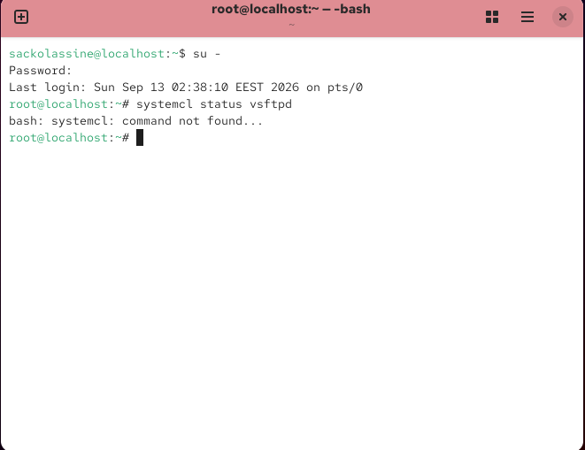

## 3.2. Установка и запуск службы

```bash
dnf -y install vsftpd
systemctl start vsftpd
systemctl status vsftpd
```

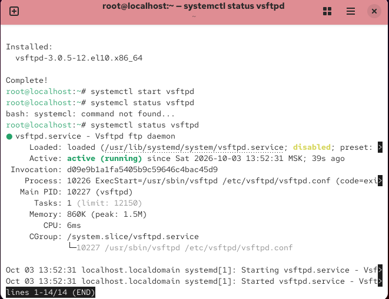

## 3.3. Управление автозапуском

```bash
systemctl enable vsftpd
systemctl status vsftpd
systemctl disable vsftpd
systemctl status vsftpd
```

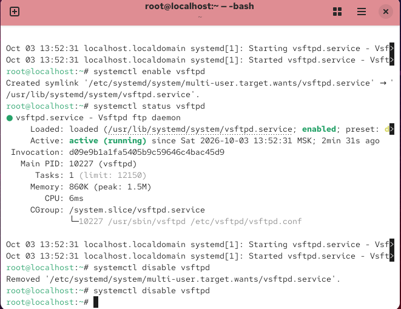

## 3.4. Проверка символических ссылок до enable

```bash
ls /etc/systemd/system/multi-user.target.wants
```

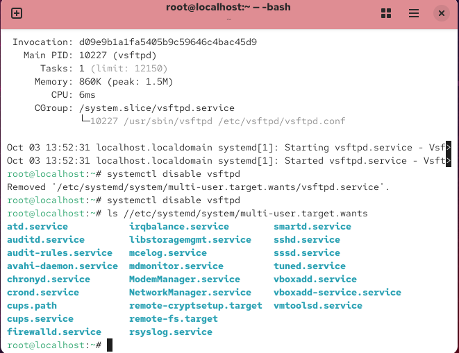

## 3.5. Проверка символических ссылок после enable

```bash
systemctl enable vsftpd
ls /etc/systemd/system/multi-user.target.wants
systemctl status vsftpd
```

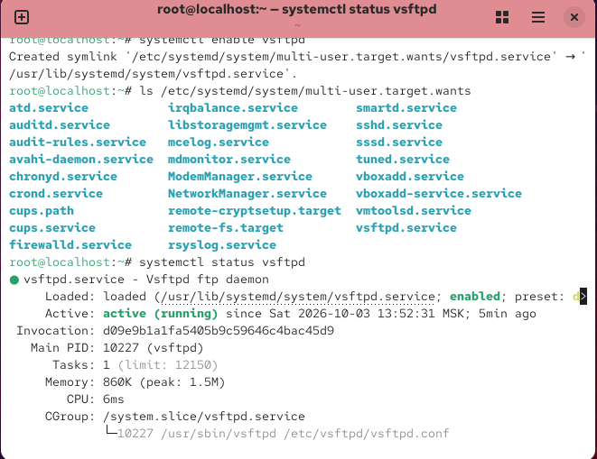

## 3.6. Зависимости службы

```bash
systemctl list-dependencies vsftpd
```

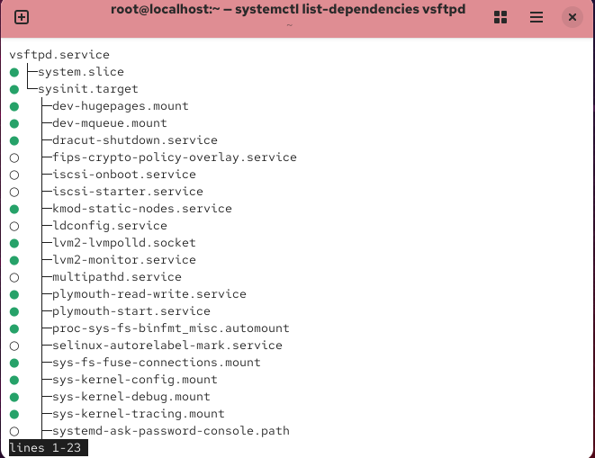

## 3.7. Обратные зависимости службы

```bash
systemctl list-dependencies vsftpd --reverse
```


## 4.1. Установка и проверка firewalld и iptables

```bash
dnf -y install iptables*
systemctl status firewalld
systemctl status iptables
```

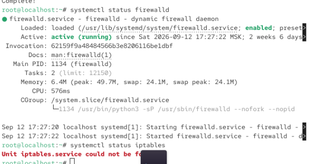

## 4.2. Демонстрация конфликта

```bash
systemctl start firewalld
systemctl start iptables
```

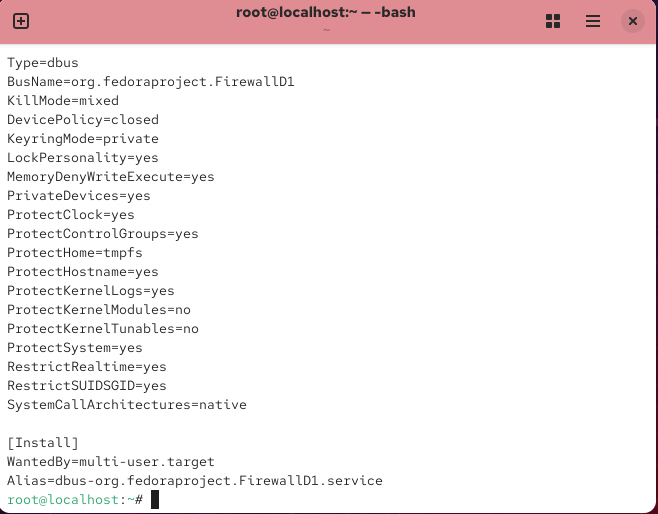

## 4.3. Файл firewalld.service

```bash
cat /usr/lib/systemd/system/firewalld.service
```

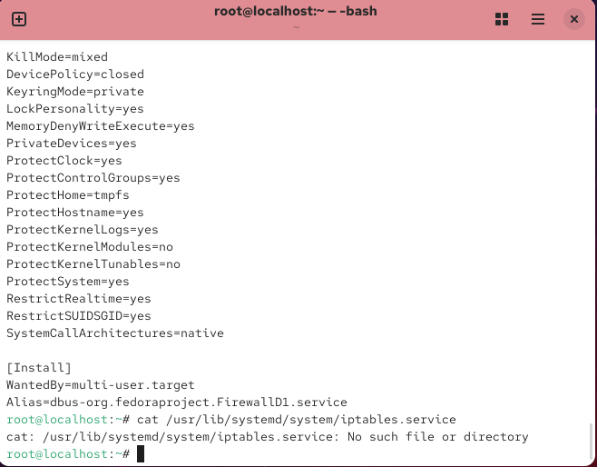

## 4.4. Файл iptables.service

```bash
cat /usr/lib/systemd/system/iptables.service
```

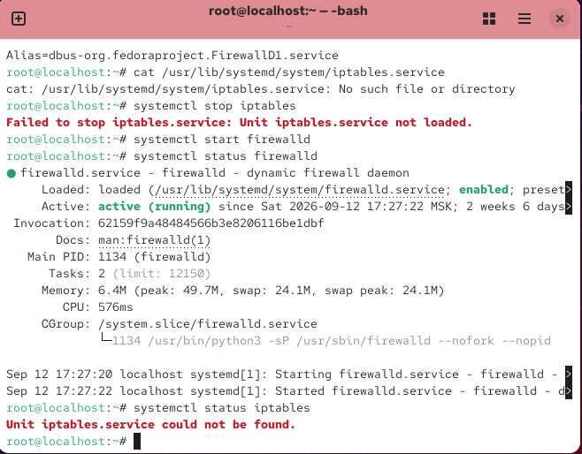

## 4.5. Остановка iptables и запуск firewalld

```bash
systemctl stop iptables
systemctl start firewalld
systemctl status firewalld
systemctl status iptables
```

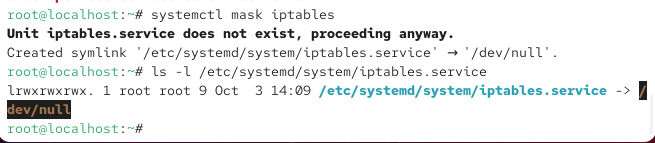

## 4.6. Маскирование iptables

```bash
systemctl mask iptables
ls -l /etc/systemd/system/iptables.service
```


## 4.7. Попытка запуска замаскированной службы

```bash
systemctl start iptables
```


## 4.8. Проверка enable для замаскированной службы

```bash
systemctl enable iptables
```

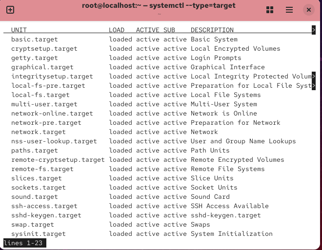

## 5.1. Активные цели

```bash
systemctl --type=target
```

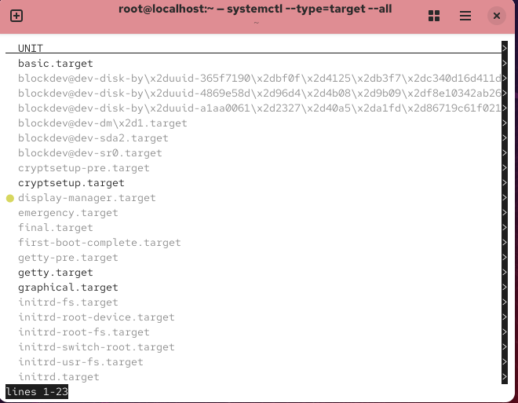

## 5.2. Все цели

```bash
systemctl --type=target --all
```

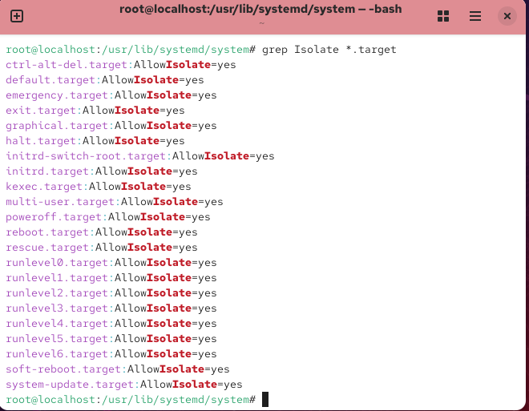

## 5.3. Изолируемые цели

```bash
cd /usr/lib/systemd/system
grep Isolate *.target
```


## 5.4. Rescue target

```bash
systemctl isolate rescue.target
```

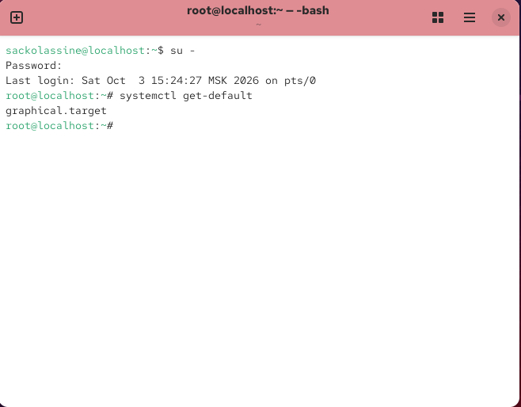

## 5.5. Reboot target

```bash
systemctl isolate reboot.target
```

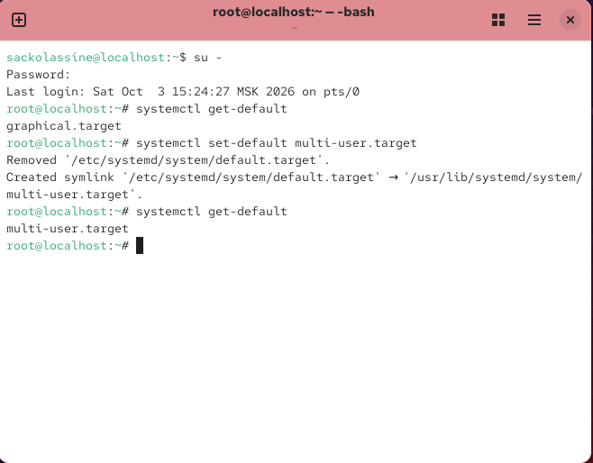

## 6.1. Проверка текущей цели

```bash
systemctl get-default
```

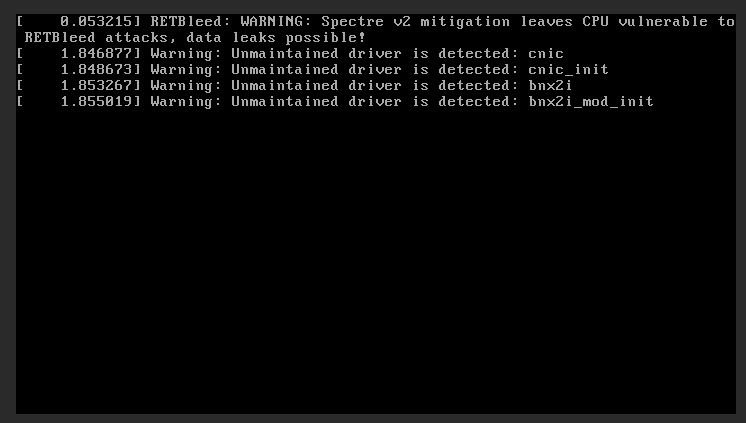

## 6.2. Установка multi-user.target

```bash
systemctl set-default multi-user.target
systemctl get-default
```

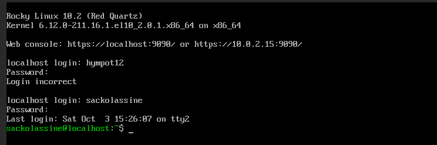

## 6.3. Установка graphical.target

```bash
systemctl set-default graphical.target
systemctl get-default
```

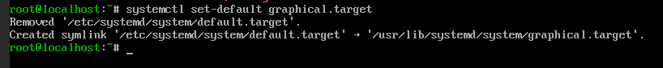

## 6.4. Возврат в графический режим

```bash
reboot
```


---

# 7. Результаты работы

В ходе лабораторной работы:

- изучено управление системными службами посредством `systemd`;
- установлена и запущена служба `vsftpd`;
- проверены статус и автозапуск службы;
- исследованы зависимости юнита;
- рассмотрен конфликт служб `firewalld` и `iptables`;
- выполнено маскирование `iptables`;
- изучены системные targets;
- исследованы изолируемые цели;
- выполнено переключение на `rescue.target`;
- исследована цель системы по умолчанию;
- выполнено переключение между `multi-user.target` и `graphical.target`.

---

# 8. Вывод

Цель лабораторной работы достигнута.

Получены практические навыки управления системными службами и системными целями операционной системы с помощью `systemd`.

---

# 9. Ответы на контрольные вопросы

## 1. Что такое юнит (unit)? Приведите примеры.

Юнит — это файл конфигурации `systemd` с определённым синтаксисом.

Примеры:

- `.service` — системная служба;
- `.socket` — сокет;
- `.mount` — монтирование файловой системы;
- `.target` — логическая группировка юнитов;
- `.timer` — работа служб по расписанию.

## 2. Какая команда позволяет убедиться, что юнит не включён в автозапуск?

```bash
systemctl is-enabled название_юнита
Для удаления из автозапуска:

systemctl disable название_юнита
3. Какую команду использовать для отображения всех загруженных сервисных юнитов?
systemctl --type=service
4. Как создать зависимость Wants для сервиса?
systemctl enable название_юнита
5. Как переключить текущее состояние на rescue target?
systemctl isolate rescue.target
6. Почему цель может не изолироваться?

Не все цели могут быть изолированы. Для изолируемых целей используется параметр AllowIsolate.

grep Isolate *.target
7. Как узнать, какие другие юниты зависят от службы?
systemctl list-dependencies название_юнита --reverse

Для vsftpd:

systemctl list-dependencies vsftpd --reverse
Заключение

Лабораторная работа №5 выполнена.

В ходе работы были изучены основные операции управления службами и системными целями с использованием systemd.
