# Лабораторная работа №5
## Управление системными службами

**Студент:** SACKO LASSINÉ

---

# Слайд 1. Цель работы

Получить навыки управления системными службами операционной системы посредством `systemd`.

---

# Слайд 2. Задание

В работе выполнены:

- основные операции со службой `vsftpd`;
- управление автозапуском службы;
- исследование зависимостей;
- работа с конфликтом `firewalld` и `iptables`;
- маскирование службы;
- работа с системными targets;
- изменение цели системы по умолчанию.

---

# Слайд 3. Работа с vsftpd

Для работы была установлена служба Very Secure FTP:

```bash
dnf -y install vsftpd
systemctl start vsftpd
systemctl status vsftpd
Слайд 4. Автозапуск vsftpd

Проверены команды:

systemctl enable vsftpd
systemctl disable vsftpd
systemctl is-enabled vsftpd

Слайд 5. Зависимости службы

Были исследованы прямые и обратные зависимости:

systemctl list-dependencies vsftpd
systemctl list-dependencies vsftpd --reverse

Слайд 6. firewalld и iptables

Был исследован конфликт двух служб:

systemctl start firewalld
systemctl start iptables

Слайд 7. Маскирование iptables

Для блокировки запуска службы использована команда:

systemctl mask iptables
systemctl start iptables

После маскирования запуск службы завершается ошибкой.

Слайд 8. Системные targets

Были исследованы активные и все доступные targets:

systemctl --type=target
systemctl --type=target --all

Слайд 9. Изолируемые targets

Для определения изолируемых целей использована команда:

cd /usr/lib/systemd/system
grep Isolate *.target

Слайд 10. Rescue и reboot targets

Были исследованы операции:

systemctl isolate rescue.target
systemctl isolate reboot.target

Слайд 11. Цель системы по умолчанию

Проверена текущая цель:

systemctl get-default

Затем выполнено переключение:

systemctl set-default multi-user.target
systemctl set-default graphical.target

Слайд 12. Результаты

В результате работы:

изучен systemd;
выполнено управление службой vsftpd;
исследованы зависимости служб;
изучен конфликт firewalld и iptables;
выполнено маскирование службы;
исследованы targets;
выполнено переключение между режимами системы.

Слайд 13. Контрольные вопросы

Основные использованные команды:

systemctl is-enabled <unit>
systemctl --type=service
systemctl enable <unit>
systemctl isolate rescue.target
systemctl list-dependencies <unit> --reverse
Слайд 14. Вывод

Цель лабораторной работы достигнута.

Получены практические навыки управления системными службами и системными целями с помощью systemd.

Спасибо за внимание!


# Captures d'écran de la soutenance

Les principales étapes de l'exécution sont illustrées ci-dessous.

## Активная служба vsftpd

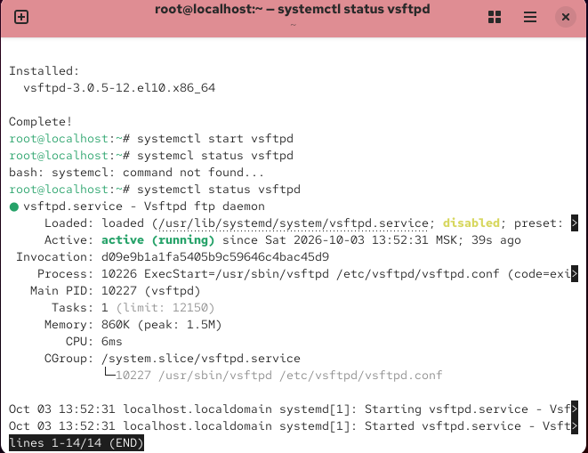

## Управление автозапуском vsftpd

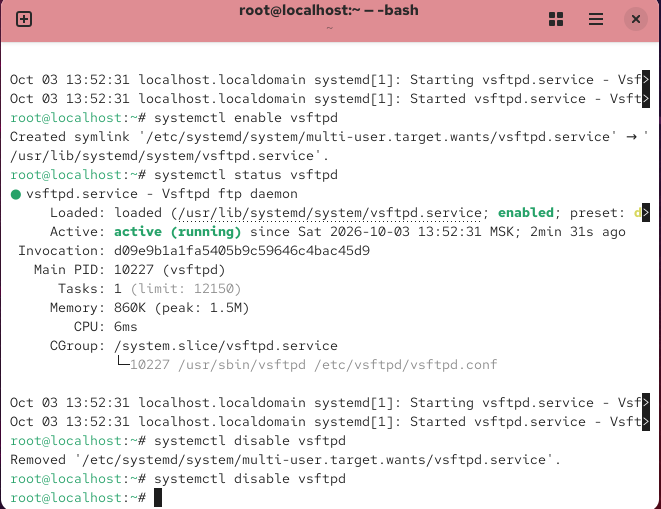

## Зависимости vsftpd

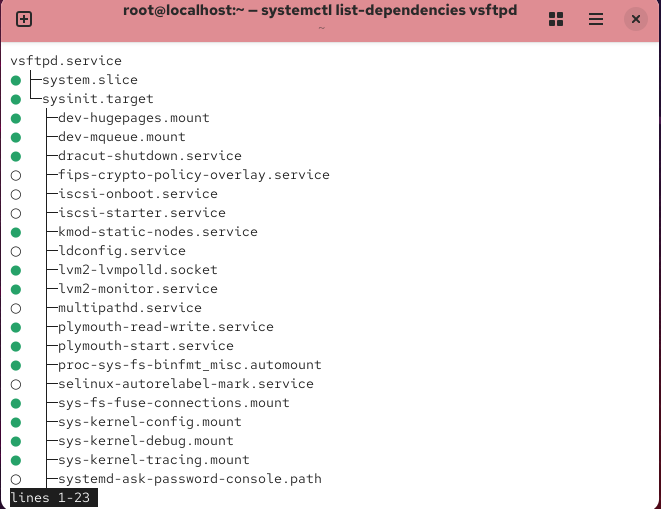

## Обратные зависимости vsftpd


## Статусы firewalld и iptables

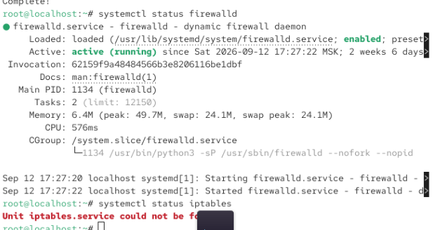

## Конфликт firewalld и iptables

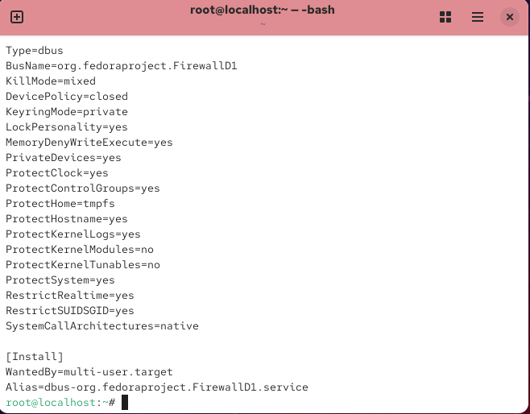

## Маскирование iptables


## Ошибка запуска iptables


## Активные targets

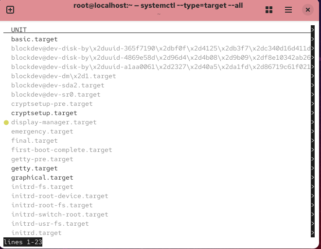

## Все targets

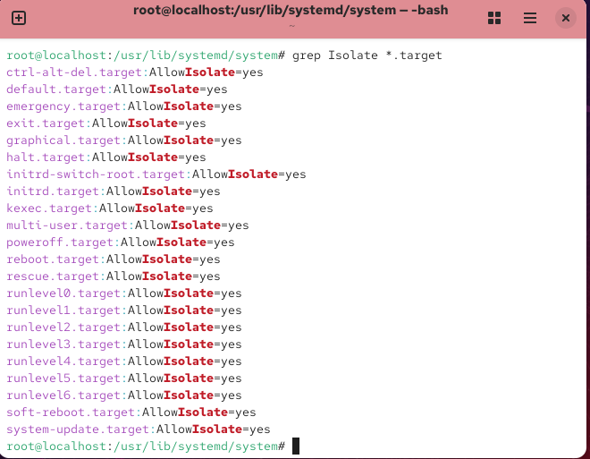

## Изолируемые targets


## Rescue target

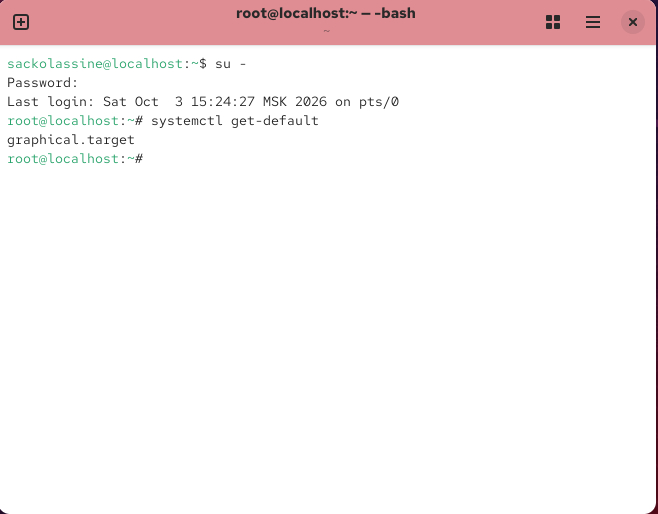

## Reboot target

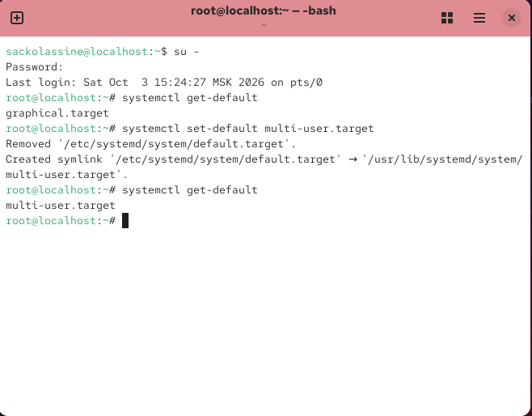

## Multi-user target

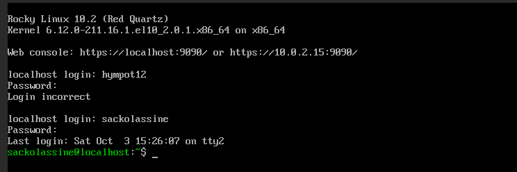

## Graphical target

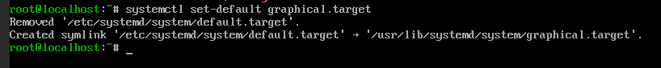

