# Лабораторная работа № 6
## Управление процессами

**Студент:** SACKO LASSINÉ  
**Операционная система:** Rocky Linux  
**Среда виртуализации:** Oracle VirtualBox  
**Хостовая операционная система:** Ubuntu

---

## 1. Цель работы

Получить практические навыки управления заданиями командной оболочки, просмотра процессов операционной системы, изменения приоритетов процессов, отправки сигналов и управления выполнением программ в фоновом и переднем режимах.

## 2. Постановка задачи

В ходе лабораторной работы необходимо:

1. Продемонстрировать управление заданиями командной оболочки.
2. Изучить способы просмотра процессов и управления ими.
3. Изменить приоритеты процессов с помощью `nice` и `renice`.
4. Выполнить самостоятельные задания с использованием `dd`, `yes`, `nohup`, `kill` и `killall`.
5. Проверить результаты команд и ответить на контрольные вопросы.

## 3. Выполнение работы

### 3.1. Управление заданиями командной оболочки

Для создания фоновых заданий использовались команды `sleep` и `dd`. Команда `sleep` позволяет приостановить выполнение на заданный промежуток времени, а `dd` в данном упражнении использовалась для создания процесса, работающего в фоновом режиме.

```bash
sleep 3600 &
dd if=/dev/zero of=/dev/null &
sleep 7200
```

Для приостановки задания переднего плана использовалась комбинация клавиш `Ctrl+Z`. Команда `jobs` показывает задания текущей оболочки.

```bash
jobs
bg %3
jobs
fg %1
```

`bg` возобновляет приостановленное задание в фоновом режиме, а `fg` переводит задание на передний план. Комбинация `Ctrl+C` используется для прерывания текущего задания.

**Результаты выполнения:**

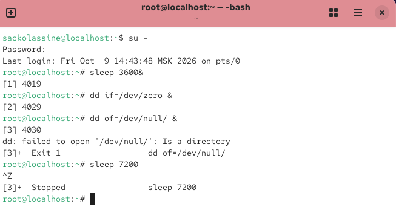

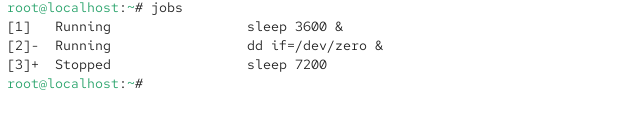

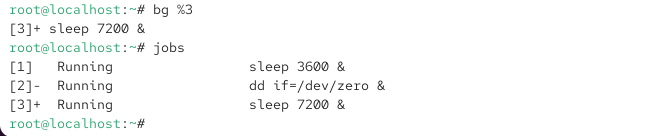


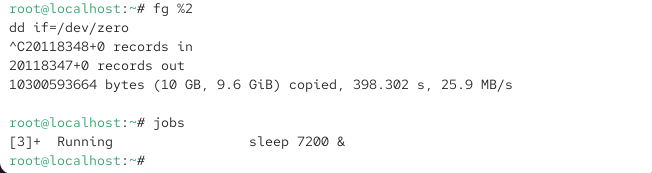

### 3.2. Просмотр процесса с помощью top

Во втором терминале был запущен фоновый процесс `dd`. Для просмотра активных процессов использовалась утилита `top`. Она позволяет наблюдать за процессами и завершать выбранный процесс с помощью клавиши `k`.

```bash
dd if=/dev/zero of=/dev/null &
top
```

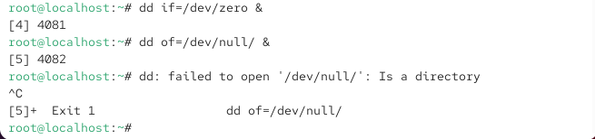

### 3.3. Просмотр процессов и изменение приоритетов

Команда `ps aux` отображает сведения о запущенных процессах. Для изменения приоритета использовалась команда `renice`. Значение nice влияет на относительный приоритет планирования процесса.

```bash
dd if=/dev/zero of=/dev/null &
dd if=/dev/zero of=/dev/null &
dd if=/dev/zero of=/dev/null &
ps aux | grep '[d]d'
renice -n 5 -p PID
ps fax | grep -B5 dd
```

В команде `renice` необходимо заменить `PID` фактическим идентификатором выбранного процесса. Для изучения иерархии процессов также использовалась команда:

```bash
ps -eo pid,ppid,user,cmd --forest
```

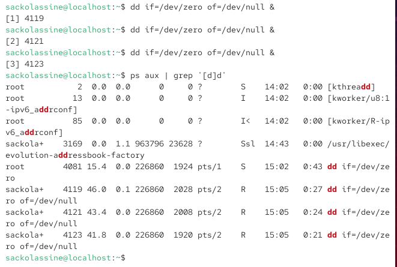

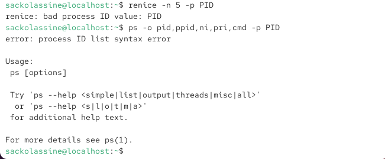

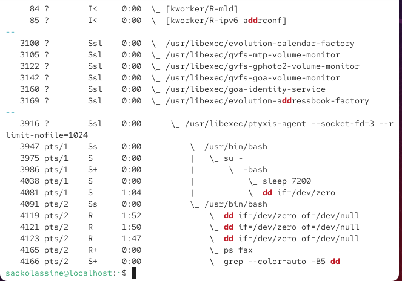

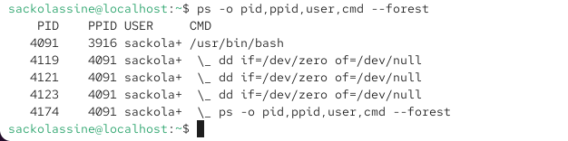

### 3.4. Самостоятельная работа. Задание 1

Были рассмотрены запуск нескольких процессов `dd`, изменение значения nice и завершение процессов, созданных для упражнения.

```bash
dd if=/dev/zero of=/dev/null &
dd if=/dev/zero of=/dev/null &
dd if=/dev/zero of=/dev/null &
ps -o pid,ni,pri,cmd -C dd
```

Для изменения приоритета одного процесса применялись следующие команды:

```bash
renice -n -5 -p PID
ps -o pid,ni,pri,cmd -p PID

renice -n -15 -p PID
ps -o pid,ni,pri,cmd -p PID
```

Отрицательные значения nice означают более высокий приоритет по сравнению с положительными значениями. Для назначения отрицательных значений обычно требуются права администратора.

После выполнения упражнения запущенные для него процессы необходимо завершить.

```bash
killall dd
ps -C dd -o pid,ni,pri,cmd
```

Команду `killall dd` следует использовать только в том случае, если все процессы `dd`, которые она затронет, относятся к данному упражнению.

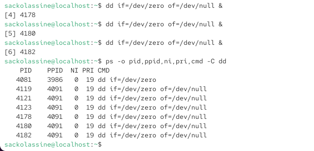

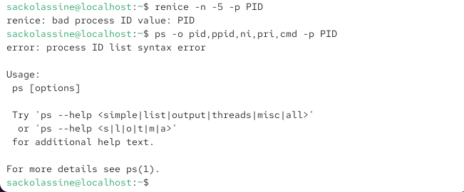

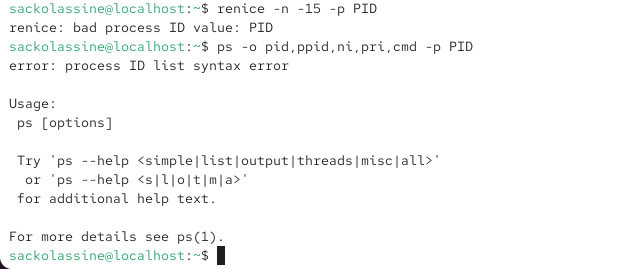

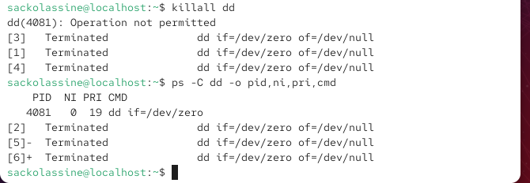

### 3.5. Самостоятельная работа. Задание 2

#### Запуск yes в фоновом режиме

Программа `yes` непрерывно выводит текст. Чтобы не перегружать терминал выводом, использовалось перенаправление в `/dev/null`.

```bash
yes > /dev/null 2>&1 &
jobs -l
```

#### Приостановка и возобновление

Для приостановки задания использовалась комбинация `Ctrl+Z`. Команды `bg` и `fg` позволяют возобновлять задание в фоновом режиме и переводить его на передний план.

```bash
yes > /dev/null 2>&1
jobs -l
bg
fg
```

При необходимости выполнения этих команд следует использовать `Ctrl+Z` и `Ctrl+C` в соответствующие моменты.

#### Запуск yes с видимым выводом

```bash
yes
```

Команда демонстрирует непрерывный вывод текста. Для прекращения вывода используется `Ctrl+C`.

#### Запуск nohup

Утилита `nohup` предназначена для запуска команды, которая должна продолжать работу при закрытии терминала или получении сигнала SIGHUP.

```bash
nohup yes > /dev/null 2>&1 &
jobs -l
ps -ef | grep '[y]es'
```

#### Просмотр и завершение процессов

Для наблюдения за процессами применялась команда `top`. Для завершения отдельного процесса используется `kill PID`, а для завершения процессов по имени — `killall`, если это безопасно для текущей системы.

```bash
top
jobs -l
ps -ef | grep '[y]es'
kill PID
kill %NUMERO
```

Здесь `PID` и `NUMERO` необходимо заменить фактическими идентификаторами процесса и задания.

Для отправки сигнала SIGHUP применяется сигнал номер 1:

```bash
kill -1 PID
```

#### Сравнение приоритетов

```bash
yes > /dev/null 2>&1 &
nice -n 5 yes > /dev/null 2>&1 &
jobs -l
ps -o pid,ni,pri,cmd -C yes
```

Для установки одинакового значения nice:

```bash
renice -n 5 -p PID1
renice -n 5 -p PID2
ps -o pid,ni,pri,cmd -p PID1,PID2
```

Все обозначения `PID`, `PID1`, `PID2` и `NUMERO` являются заполнителями и должны заменяться реальными значениями, полученными в терминале.

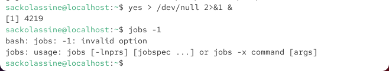

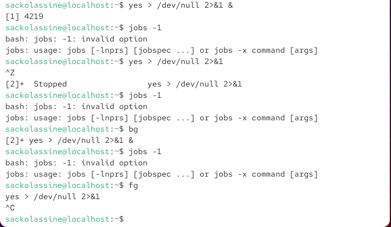


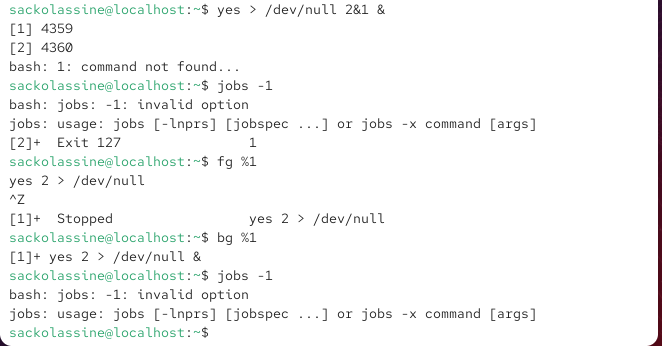

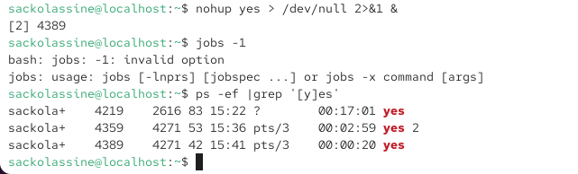

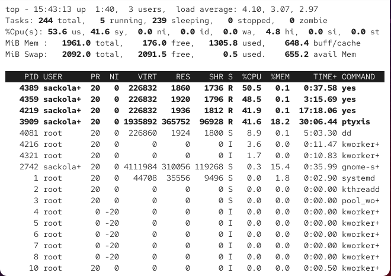

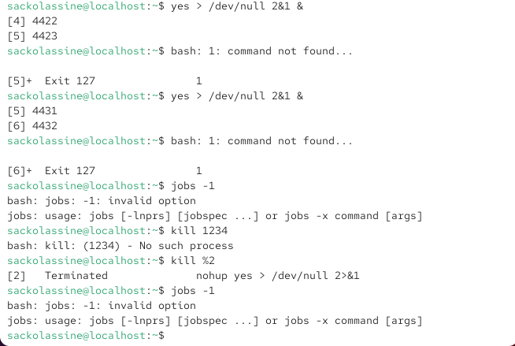

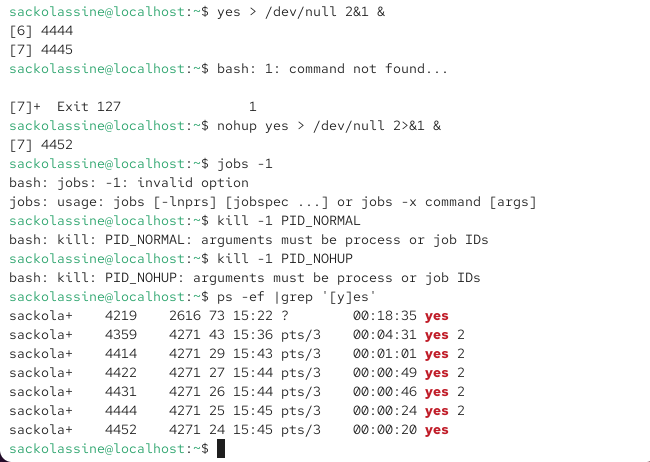

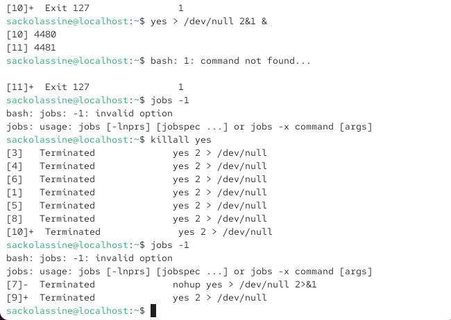

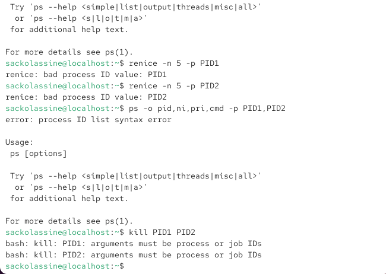

## 4. Ответы на контрольные вопросы

**1. Какая команда показывает все текущие задания оболочки?**

Команда `jobs`.

**2. Как приостановить текущее задание, чтобы продолжить его в фоне?**

Нажать `Ctrl+Z`, затем выполнить `bg`.

**3. Какой комбинацией клавиш можно отменить текущее задание?**

`Ctrl+C`.

**4. Как завершить процесс, если нет доступа к оболочке, в которой он запущен?**

Открыть другой терминал и использовать `kill PID`, если известен идентификатор процесса, либо подходящую команду `pkill` или `killall`.

**5. Какая команда отображает отношения между родительскими и дочерними процессами?**

Например, `ps fax` или `pstree`.

**6. Как повысить приоритет процесса с PID 1234?**

С правами администратора:

```bash
renice -n -5 -p 1234
```

Меньшее значение nice означает более высокий приоритет.

**7. Как проще всего завершить 20 процессов dd?**

Если все процессы с именем `dd` относятся к нужной операции, можно использовать `killall dd`. В остальных случаях следует выбрать только нужные PID.

**8. Как завершить процесс с именем mycommand?**

```bash
killall mycommand
```

**9. Какая клавиша в top позволяет завершить процесс?**

Клавиша `k`.

**10. Как запустить команду с более низким приоритетом, чтобы не мешать другим процессам?**

Использовать `nice` с положительным значением, например:

```bash
nice -n 5 команда
```

## 5. Вывод

В ходе лабораторной работы были изучены команды управления заданиями командной оболочки и процессами Linux. Рассмотрены переходы между передним и фоновым режимами, приостановка и завершение заданий, просмотр процессов и их иерархии, изменение приоритетов с помощью `nice` и `renice`, а также применение `nohup`, `kill` и `killall`.

Полученные навыки позволяют наблюдать за состоянием процессов, управлять их выполнением и корректно завершать задачи. При работе с командами завершения процессов необходимо проверять PID и убеждаться, что выбранный процесс относится к текущему упражнению.
