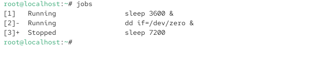
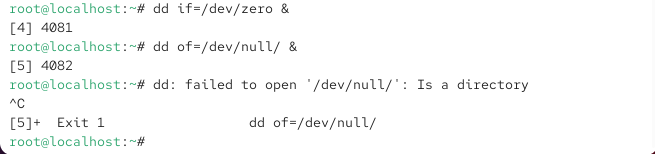
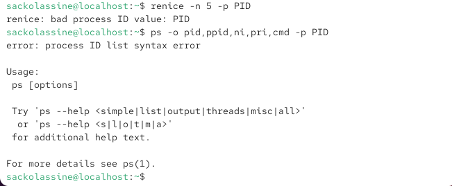
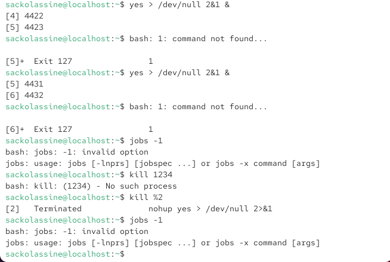
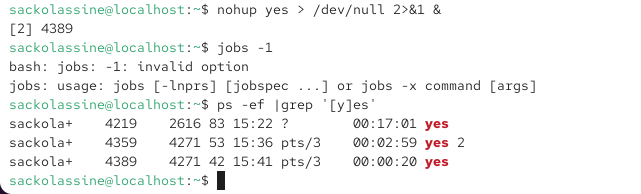

% Лабораторная работа № 6
% Управление процессами
% SACKO LASSINÉ

---

# Цель работы

- Изучить основные средства управления процессами в Linux.
- Научиться управлять заданиями оболочки.
- Изучить приоритеты процессов и сигналы.
- Освоить команды `ps`, `jobs`, `fg`, `bg`, `kill`, `nice`, `renice` и `nohup`.

---

# Основные задачи

В ходе лабораторной работы изучены:

- Управление заданиями в фоновом и foreground-режиме.
- Просмотр процессов и их иерархии.
- Изменение приоритетов процессов.
- Завершение процессов и отправка сигналов.
- Запуск процессов, продолжающих работу после закрытия терминала.

---

# 1. Управление заданиями

Основные команды:

- `jobs` — просмотр заданий текущей оболочки.
- `Ctrl+Z` — приостановка foreground-задания.
- `bg` — продолжение задания в фоновом режиме.
- `fg` — возврат задания в foreground.
- `Ctrl+C` — прерывание текущего задания.

---

# 2. Просмотр процессов

Команды для анализа процессов:

- `ps aux` — просмотр списка процессов.
- `top` — интерактивный мониторинг процессов.
- `ps fax` — просмотр иерархии процессов.
- `grep` — поиск процессов по имени в выводе команды.

---

# 3. Приоритеты процессов

- `nice` — запуск процесса с заданным значением nice.
- `renice` — изменение приоритета уже запущенного процесса.
- Чем выше значение nice, тем ниже приоритет планирования CPU.
- Отрицательные значения nice повышают приоритет и обычно требуют прав администратора.

Пример:

`renice -n 5 -p PID`

---

# 4. Завершение процессов

Для управления процессами применяются:

- `kill PID` — отправка сигнала процессу.
- `kill -9 PID` — принудительное завершение процесса.
- `killall имя` — отправка сигнала процессам с указанным именем.
- `top` — интерактивный просмотр и завершение процессов.

Перед завершением необходимо проверить PID и убедиться, что выбран нужный процесс.

---

# 5. Фоновые процессы и nohup

- Символ `&` запускает команду в фоновом режиме.
- `nohup` позволяет процессу продолжить работу после закрытия терминала в обычных условиях.
- `kill` позволяет отправлять сигналы отдельным процессам.
- `killall` помогает завершить несколько процессов с одинаковым именем.

---

# Результаты работы

В ходе лабораторной работы выполнены практические задания по:

- управлению заданиями оболочки;
- просмотру процессов и их иерархии;
- изменению приоритетов;
- завершению процессов и отправке сигналов;
- запуску фоновых процессов и использованию `nohup`.

Практические действия зафиксированы на скриншотах.

---

# Заключение

Цель лабораторной работы достигнута.

Получены практические навыки управления процессами в Linux, работы с фоновыми заданиями, изменения приоритетов, отправки сигналов и анализа состояния системы.

Спасибо за внимание!
