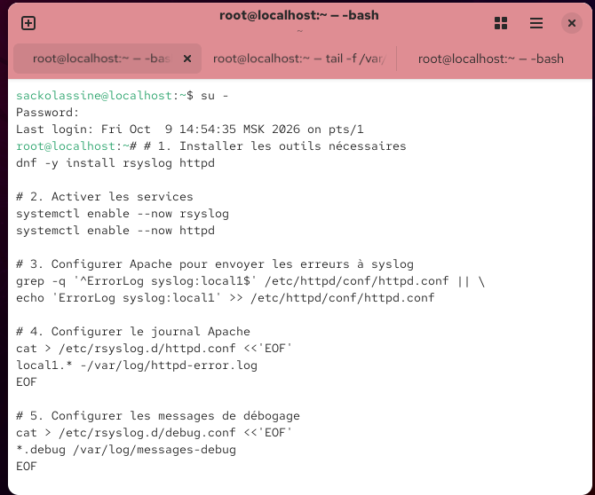
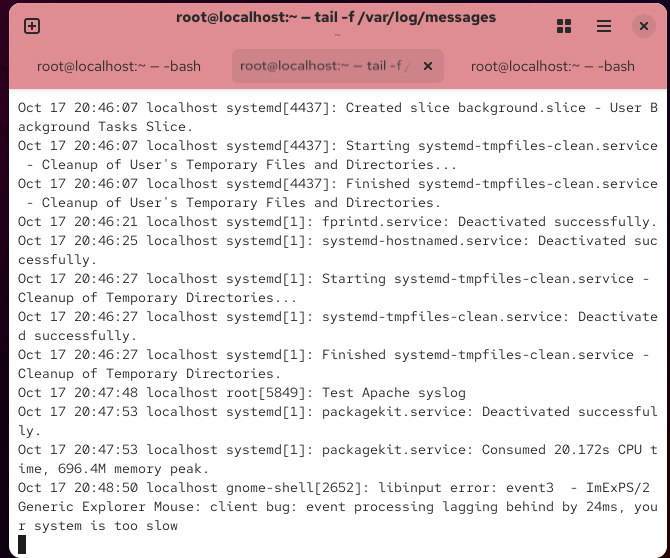
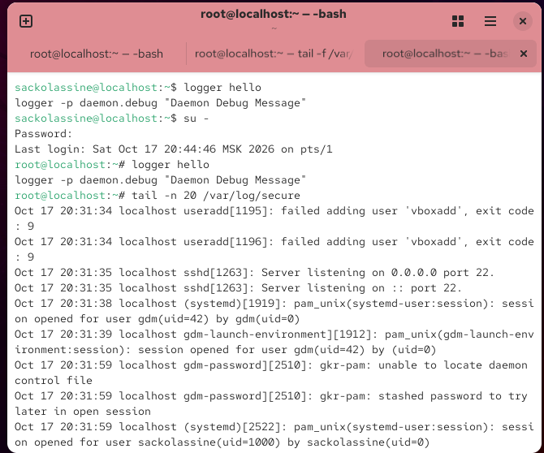
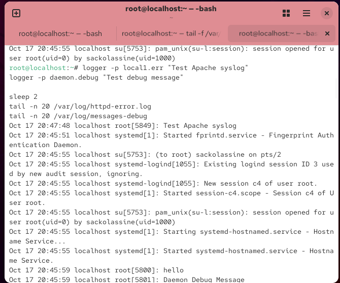
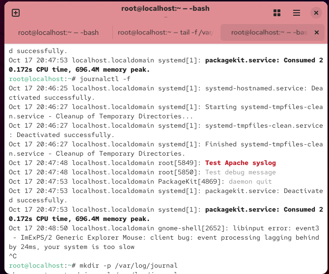
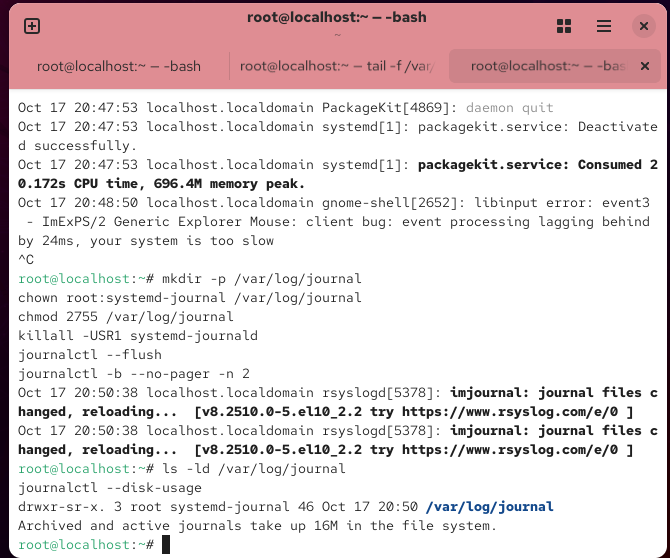

# Лабораторная работа № 7
## Управление журналами событий в системе

**Студент:** SACKO LASSINÉ  
**Операционная система:** Rocky Linux  
**Виртуальная среда:** VirtualBox

---

## 1. Цель работы

Получить практические навыки мониторинга системных событий Linux, настройки rsyslog, просмотра журналов с помощью journalctl и организации постоянного хранения журналов journald.

## 2. Задание

1. Продемонстрировать мониторинг системных событий в реальном времени.
2. Настроить регистрацию сообщений веб-службы Apache через rsyslog.
3. Продемонстрировать работу с journalctl.
4. Настроить постоянное хранение журнала journald.

## 3. Ход выполнения работы

### 3.1. Мониторинг системных событий

Для просмотра системных сообщений в реальном времени используется команда:

```bash
tail -f /var/log/messages
```

Для создания тестового сообщения применяется команда:

```bash
logger hello
```

Сообщения, связанные с аутентификацией, проверяются в журнале:

```bash
tail -n 20 /var/log/secure
```

**Результат:** команды используются для наблюдения за системными событиями и проверки регистрации сообщений. Фактический результат подтверждается снимком экрана.





### 3.2. Настройка rsyslog и Apache

Для настройки регистрации сообщений Apache используется файл:

`/etc/httpd/conf/httpd.conf`

В конфигурацию добавляется строка:

```text
ErrorLog syslog:local1
```

В файле `/etc/rsyslog.d/httpd.conf` задаётся правило:

```text
local1.* -/var/log/httpd-error.log
```

Для регистрации отладочных сообщений создаётся файл `/etc/rsyslog.d/debug.conf` со строкой:

```text
*.debug /var/log/messages-debug
```

После изменения конфигурации проверяется её корректность и перезапускаются службы:

```bash
rsyslogd -N1
systemctl restart rsyslog
apachectl configtest
systemctl restart httpd
```

Для проверки регистрации можно отправить тестовые сообщения:

```bash
logger -p local1.err "Test Apache syslog"
logger -p daemon.debug "Test debug message"
```

**Результат:** настройка считается проверенной после успешной проверки конфигурации и появления тестовых сообщений в соответствующих журналах.





### 3.3. Работа с journalctl

Для просмотра последних записей используется команда:

```bash
journalctl --no-pager -n 20
```

Для просмотра сообщений об ошибках:

```bash
journalctl -p err --no-pager
```

Для просмотра событий текущей загрузки:

```bash
journalctl -b --no-pager
```

Для мониторинга новых сообщений в реальном времени:

```bash
journalctl -f
```

Для выхода из режима мониторинга используется `Ctrl+C`.

**Результат:** journalctl предоставляет средства просмотра и фильтрации системных событий.



### 3.4. Настройка постоянного хранения journald

Для организации постоянного хранения журнала создаётся каталог:

```bash
mkdir -p /var/log/journal
```

Настраиваются владелец и права доступа:

```bash
chown root:systemd-journal /var/log/journal
chmod 2755 /var/log/journal
```

Для применения изменений используется команда:

```bash
killall -USR1 systemd-journald
```

После этого проверяется каталог и состояние журнала:

```bash
ls -ld /var/log/journal
journalctl --disk-usage
journalctl -b --no-pager -n 20
```

**Результат:** наличие каталога и доступность записей проверяются командами выше. Сохранение записей после перезагрузки подтверждается отдельной проверкой после перезагрузки системы.



## 4. Ответы на контрольные вопросы

### 1. Какой файл используется для настройки rsyslogd?

Основной файл конфигурации — `/etc/rsyslog.conf`. Дополнительные правила могут размещаться в каталоге `/etc/rsyslog.d/`.

### 2. В каком файле находятся сообщения, связанные с аутентификацией?

В системах семейства RHEL, включая Rocky Linux, обычно используется файл `/var/log/secure`.

### 3. Если ничего не настраивать, сколько времени потребуется для ротации журналов?

Период ротации определяется конфигурацией logrotate, обычно задаваемой в `/etc/logrotate.conf` и файлах `/etc/logrotate.d/`. Его необходимо проверить в конкретной системе.

### 4. Как записывать сообщения с приоритетом info в файл `/var/log/messages.info`?

Можно добавить правило:

```text
*.info /var/log/messages.info
```

Следует учитывать, что такой селектор включает сообщения уровня info и более высоких уровней важности.

### 5. Какая команда показывает сообщения журнала в реальном времени?

```bash
journalctl -f
```

Для отдельного текстового файла журнала можно использовать `tail -f имя_файла`.

### 6. Как просмотреть сообщения для PID 1 между 9:00 и 15:00?

```bash
journalctl _PID=1 --since "09:00:00" --until "15:00:00"
```

При необходимости следует указать конкретную дату в параметрах `--since` и `--until`.

### 7. Как просмотреть сообщения journald после последней перезагрузки?

```bash
journalctl -b
```

### 8. Как сделать журнал journald постоянным?

Создать каталог `/var/log/journal`, назначить владельца `root:systemd-journal`, установить права `2755`, а затем применить изменения перезапуском системы либо командой:

```bash
killall -USR1 systemd-journald
```

Постоянство хранения следует подтвердить проверкой записей после перезагрузки.

## 5. Вывод

В ходе лабораторной работы были рассмотрены способы мониторинга системных событий Linux, настройки rsyslog для регистрации сообщений Apache, фильтрации записей с помощью journalctl и организации постоянного хранения journald.

Эти средства позволяют контролировать состояние операционной системы, анализировать системные события и диагностировать ошибки. Корректность выполненных настроек подтверждается фактическими результатами команд и приложенными снимками экрана.
