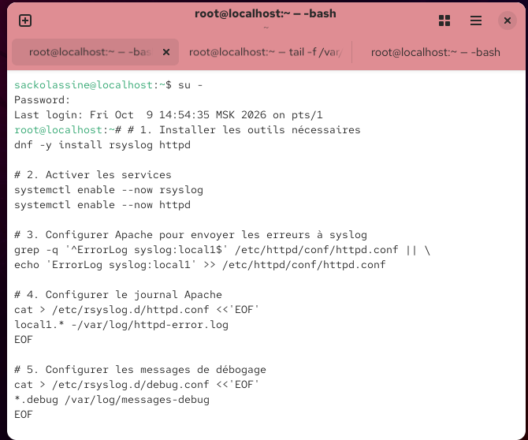
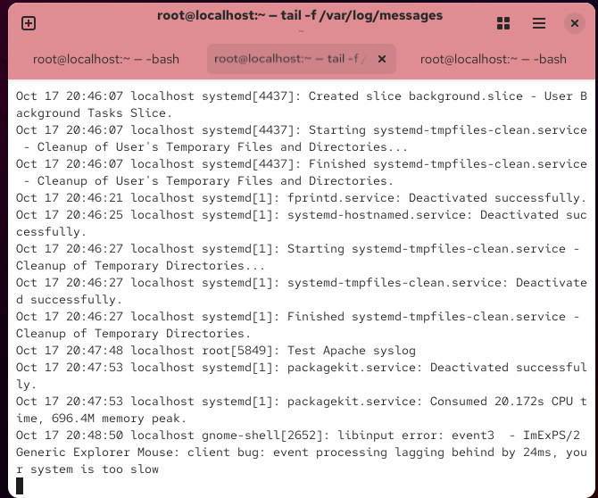
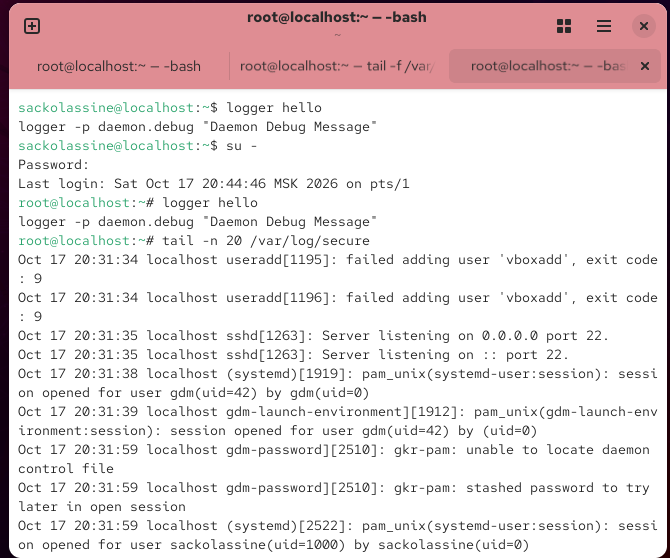
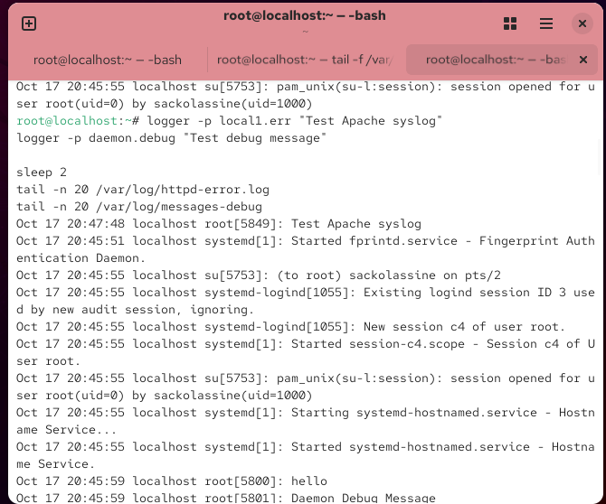
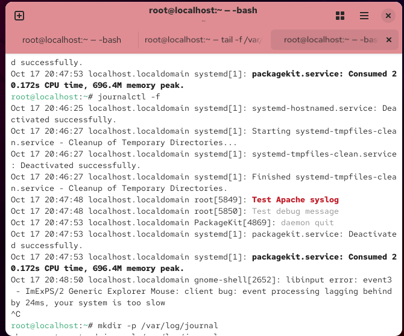
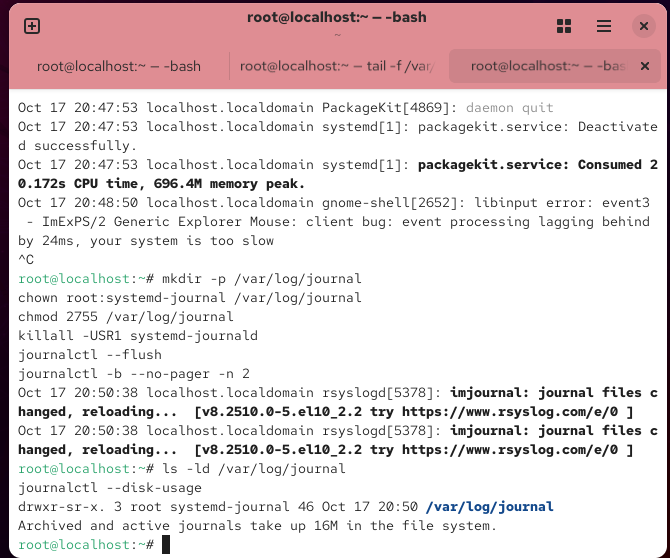

# Цель работы

Получить практические навыки мониторинга системных событий Linux.

- Мониторинг журналов в реальном времени
- Настройка `rsyslog` и Apache
- Анализ событий с помощью `journalctl`
- Постоянное хранение журналов `journald`

---

## 1. Мониторинг системных событий

::: {.columns}
::: {.column width="50%"}
```bash
tail -f /var/log/messages
logger hello
tail -n 20 /var/log/secure
```

Команды позволяют наблюдать системные сообщения и проверять журнал безопасности.
:::
::: {.column width="50%"}
{width=100%}
:::
:::

---

## 2. Проверка регистрации сообщений

::: {.columns}
::: {.column width="50%"}
```bash
logger hello
```

Команда `logger` отправляет тестовое сообщение в системный журнал. Результат проверяется в терминале мониторинга.
:::
::: {.column width="50%"}
{width=100%}
:::
:::

---

## 3. Настройка rsyslog и Apache

::: {.columns}
::: {.column width="50%"}
Конфигурация Apache:

```text
ErrorLog syslog:local1
```

Правило `/etc/rsyslog.d/httpd.conf`:

```text
local1.* -/var/log/httpd-error.log
```
:::
::: {.column width="50%"}
{width=100%}
:::
:::

---

## 4. Проверка конфигурации

::: {.columns}
::: {.column width="50%"}
```bash
rsyslogd -N1
systemctl status rsyslog
systemctl status httpd
```

Проверяются корректность конфигурации и состояние служб.
:::
::: {.column width="50%"}
{width=100%}
:::
:::

---

## 5. Работа с journalctl

::: {.columns}
::: {.column width="50%"}
```bash
journalctl -n 20
journalctl -p err
journalctl -b
journalctl -f
```

Команды позволяют просматривать последние записи, ошибки и события в реальном времени.
:::
::: {.column width="50%"}
{width=100%}
:::
:::

---

## 6. Постоянное хранение journald

::: {.columns}
::: {.column width="50%"}
Каталог для постоянного хранения:

```text
/var/log/journal
```

Проверяются права доступа и состояние журнала. Сохранение между перезагрузками требует отдельной проверки.
:::
::: {.column width="50%"}
{width=100%}
:::
:::

---

# Вывод

- Изучен мониторинг системных событий Linux.
- Рассмотрена настройка `rsyslog` и Apache.
- Изучены фильтрация и просмотр журналов с помощью `journalctl`.
- Рассмотрено постоянное хранение `journald`.

**Спасибо за внимание!**
