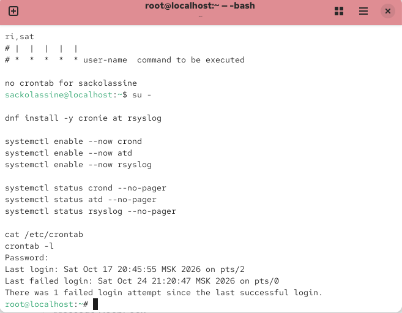
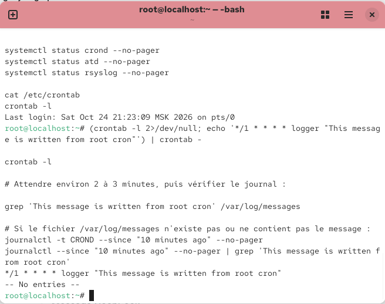
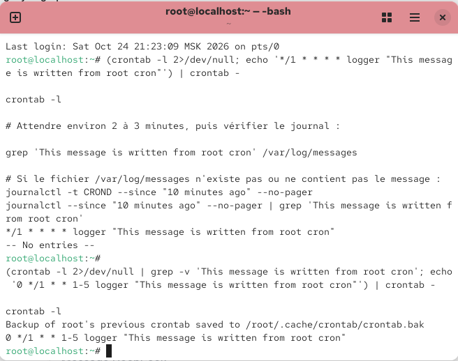
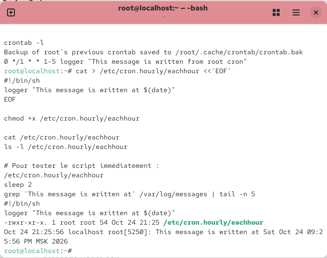
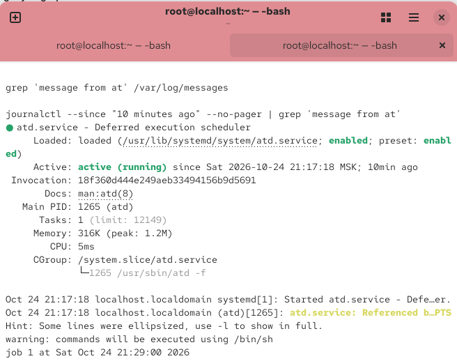
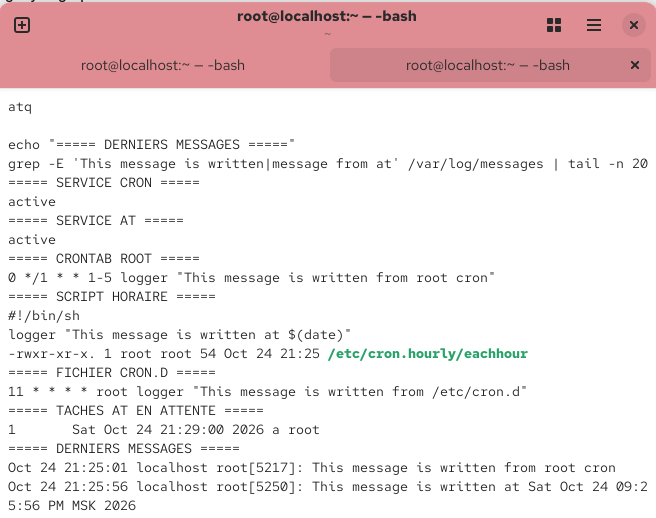

# 1. Цель работы

Получить практические навыки работы с планировщиками событий `cron` и `at` в Linux.

# 2. Выполнение работы

## 2.1. Проверка служб

Проверены службы `crond`, `atd` и `rsyslog`, а также содержимое файла `/etc/crontab`.



## 2.2. Планирование задач с помощью cron

Создано периодическое задание:

```bash
*/1 * * * * logger "This message is written from root cron"
```

Проверено содержимое расписания с помощью `crontab -l` и выполнена проверка системного журнала.





## 2.3. Изменение расписания

Настроено задание на начало каждого часа с понедельника по пятницу:

```bash
0 */1 * * 1-5 logger "This message is written from root cron"
```



## 2.4. Сценарий cron.hourly

Создан сценарий `/etc/cron.hourly/eachhour`:

```bash
#!/bin/sh
logger "This message is written at $(date)"
```

Файл сделан исполняемым и проверен запуском.



## 2.5. Задание в cron.d

Создан файл `/etc/cron.d/eachhour`:

```text
11 * * * * root logger "This message is written from /etc/cron.d"
```

Задание предназначено для запуска на 11-й минуте каждого часа.



## 2.6. Одноразовая задача at

Для планирования одноразовой задачи использована команда:

```bash
echo 'logger "message from at"' | at now + 2 minutes
```

Результат выполнения задания необходимо подтвердить фактическим выводом команды и системного журнала.
Список заданий проверен командой `atq`, а результат запуска — по системному журналу.


# 3. Контрольные вопросы

## 1. Как настроить задание cron раз в две недели?

Стандартный формат cron не содержит отдельного поля для интервала в две недели. Можно использовать проверку номера недели в скрипте или `anacron` в подходящем сценарии.

## 2. Как запускать задание 1-го и 15-го числа каждого месяца в 2 часа ночи?

```text
0 2 1,15 * * команда
```

## 3. Как запускать задание каждые две минуты?

```text
*/2 * * * * команда
```

## 4. Как запускать задание 19 сентября ежегодно?

```text
0 0 19 9 * команда
```

## 5. Как запускать задание каждый четверг сентября?

```text
0 0 * 9 4 команда
```

## 6. Как назначить задание пользователю alice?

```bash
crontab -u alice -e
```

## 7. Как запретить пользователю bob использовать cron?

Можно добавить `bob` в `/etc/cron.deny`, если используемая конфигурация cron поддерживает этот механизм и не переопределяет его через `/etc/cron.allow`.

## 8. Как выполнить ежедневное задание, пропущенное из-за выключения сервера?

Можно использовать `anacron`, если он установлен и настроен для соответствующего задания.

## 9. Как проверить задания at?

```bash
atq
```

# 4. Вывод

В ходе лабораторной работы изучены регулярное планирование задач с помощью `cron`, запуск сценариев из системных каталогов планирования и планирование одноразовых задач с помощью `at`. Результаты выполнения необходимо подтвердить фактическими выводами команд и приложенными снимками экрана.
