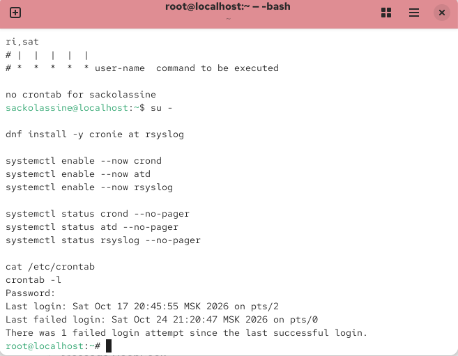
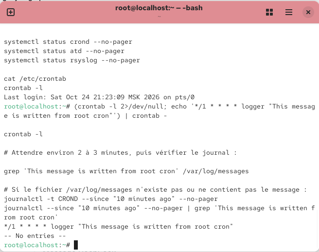
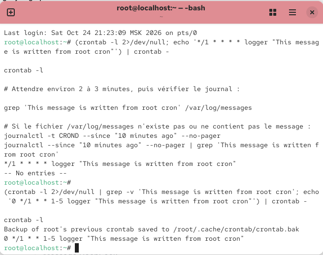
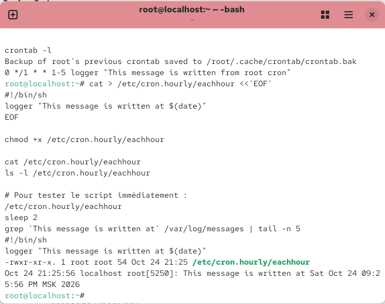
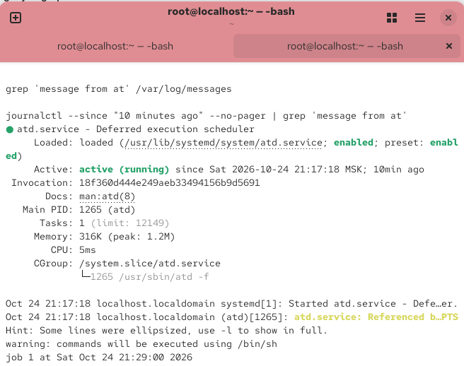
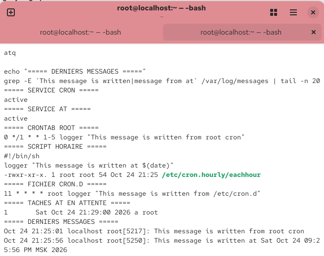

## Цель работы

Получить практические навыки работы с планировщиками событий `cron` и `at` в Linux.

- `cron` — планирование регулярных задач
- `at` — планирование одноразовых задач
- Проверка результатов через системные журналы

---

## 1. Проверка служб

Проверены службы `crond`, `atd` и `rsyslog`, а также конфигурация `/etc/crontab`.

{width=82%}

---

## 2. Планирование задач с помощью cron

Пример задания, выполняемого каждую минуту:

```bash
*/1 * * * * logger "This message is written from root cron"
```

Расписание проверяется командой `crontab -l`, а сообщения — через системный журнал.

{width=76%}

---

## 3. Проверка системного журнала

После запуска задания проверяется наличие соответствующего сообщения в журнале.

{width=82%}

---

## 4. Изменение расписания

```bash
0 */1 * * 1-5 logger "This message is written from root cron"
```

Задание запускается в начале каждого часа с понедельника по пятницу.

{width=82%}

---

## 5. Сценарий cron.hourly

Создан сценарий `/etc/cron.hourly/eachhour` для записи сообщения с текущей датой в системный журнал.

```bash
#!/bin/sh
logger "This message is written at $(date)"
```

{width=82%}

---

## 6. Настройка cron.d

Файл `/etc/cron.d/eachhour` содержит задание:

```text
11 * * * * root logger "This message is written from /etc/cron.d"
```

Оно предназначено для запуска на 11-й минуте каждого часа.

{width=82%}

---

## 7. Одноразовая задача at

Для планирования одноразовой задачи используется команда:

```bash
echo 'logger "message from at"' | at now + 2 minutes
```

Список ожидающих задач проверяется командой `atq`. После назначенного времени результат проверяется в журнале.

---

## Вывод

- Изучено планирование регулярных задач с помощью `cron`.
- Рассмотрены системные каталоги `cron.hourly` и `cron.d`.
- Изучено планирование одноразовых задач с помощью `at`.
- Рассмотрены способы проверки результатов через системные журналы.

**Спасибо за внимание!**
