```{=latex}
\begin{titlepage}
\begin{center}
\textbf{Российский университет дружбы народов}\\
\textbf{Факультет физико-математических и естественных наук}\\[3cm]
{\Large ЛАБОРАТОРНАЯ РАБОТА № 10}\\[0.5cm]
{\large Основы работы с модулями ядра операционной системы}
\end{center}

\vfill
\begin{flushright}
Выполнил: студент\\
Сако Лассине
\end{flushright}
\vfill

\begin{center}
Москва — 2026
\end{center}
\end{titlepage}

\clearpage
\tableofcontents
\clearpage
```

# Цель работы

Получить практические навыки работы с утилитами управления модулями ядра операционной системы Linux, изучить загрузку и выгрузку модулей, просмотр их параметров, а также ознакомиться с процессом обновления ядра.

# Задание

1. Продемонстрировать управление модулями ядра операционной системы.
2. Продемонстрировать загрузку модулей ядра с параметрами.
3. Изучить команды получения информации о версии ядра и его обновления.

# Ход выполнения работы

## Управление модулями ядра

Для получения информации об устройствах и связанных с ними модулях ядра была выполнена команда `lspci -k`.

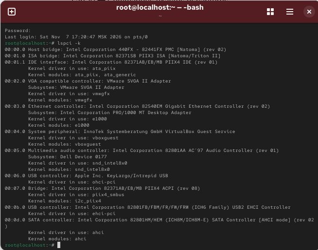

Для просмотра загруженных модулей ядра использовалась команда `lsmod | sort`.

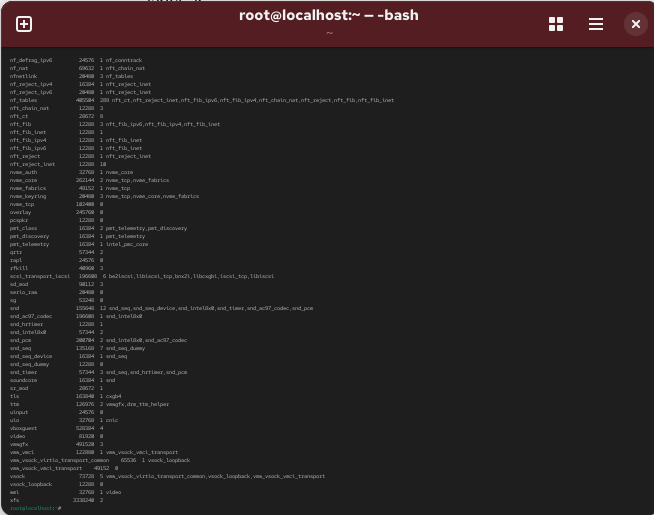

С помощью команды `lsmod | grep ext4` был проверен модуль ext4.

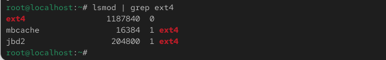

Загрузка модуля выполнялась командой `modprobe ext4`. После этого была повторно проверена информация о модуле.

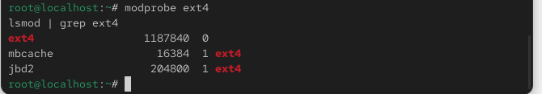

Для получения подробной информации о модуле использовалась команда `modinfo ext4`.

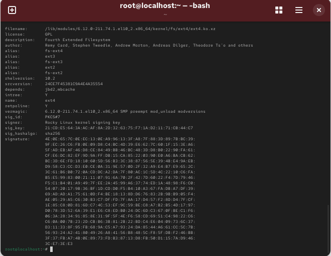

Выгрузка модуля выполнялась командой `modprobe -r ext4`.


Также была предпринята попытка выгрузить модуль xfs. Результат выполнения команды `modprobe -r xfs` представлен ниже.

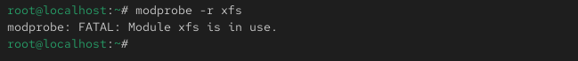

## Работа с модулем Bluetooth

Сначала была проверена информация о загруженном модуле Bluetooth с помощью команды `lsmod | grep bluetooth`.

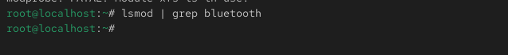

Загрузка модуля выполнялась командой `modprobe bluetooth`.

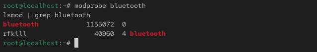

Команда `modinfo bluetooth` позволила получить сведения о модуле и его параметрах.

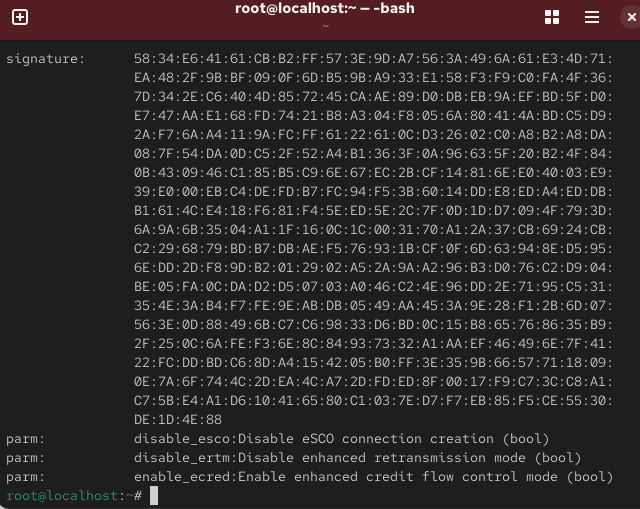

После выполнения эксперимента была произведена попытка выгрузки модуля командой `modprobe -r bluetooth`.

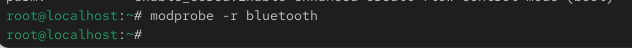

## Обновление ядра операционной системы

Для определения текущей версии ядра была использована команда `uname -r`.

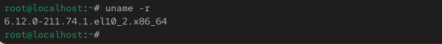

Список доступных пакетов ядра был получен командой `dnf list kernel`.

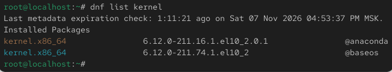

Далее была выполнена команда `dnf upgrade --refresh` для обновления информации о пакетах и проверки доступных обновлений.

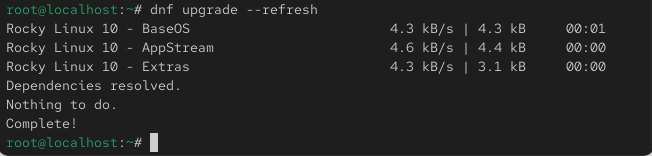

Для обновления ядра использовалась команда `dnf update kernel`.

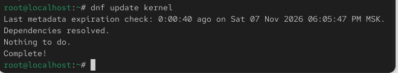

Также была выполнена команда `dnf update`.

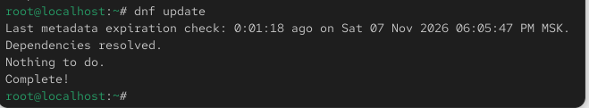

После этого повторно была выполнена команда `dnf upgrade --refresh`.

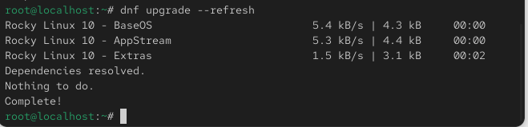

После перезагрузки системы версия ядра была проверена повторно с помощью команды `uname -r`.

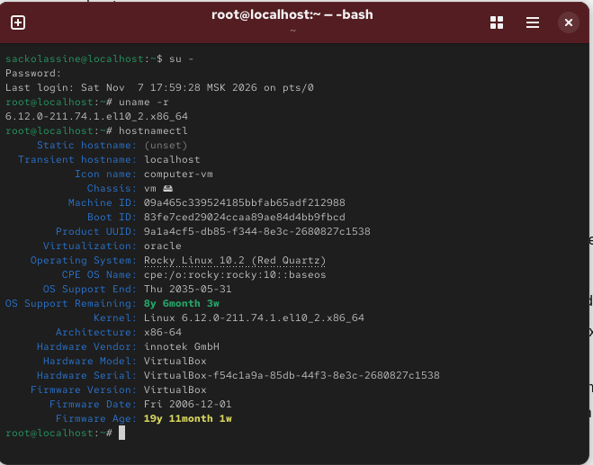

# Выводы

В ходе лабораторной работы были изучены основные средства управления модулями ядра Linux. Были выполнены команды просмотра списка загруженных модулей, получения информации о модулях, их загрузки и выгрузки. Также были рассмотрены команды проверки версии ядра, поиска пакетов ядра и выполнения обновления операционной системы.

# Ответы на контрольные вопросы

## 1. Какой командой можно посмотреть текущую версию ядра?

Для просмотра текущей версии ядра используется команда:

`uname -r`

## 2. Как получить более подробную информацию о текущей версии ядра?

Для получения подробной информации используется команда:

`uname -a`

Также можно использовать:

`hostnamectl`

## 3. Какой командой можно посмотреть список загруженных модулей ядра?

Для просмотра списка загруженных модулей используется команда:

`lsmod`

## 4. Как определить параметры модуля ядра?

Для получения информации о модуле и его параметрах используется команда:

`modinfo имя_модуля`

## 5. Как выгрузить модуль ядра?

Для выгрузки модуля используется команда:

`modprobe -r имя_модуля`

## 6. Что делать, если при выгрузке модуля возникает ошибка?

Необходимо проверить, используется ли модуль другими модулями, устройствами или процессами. При необходимости следует остановить соответствующие службы и процессы, после чего повторить выгрузку. Принудительная выгрузка используемого модуля может привести к нестабильности системы.

## 7. Как определить поддерживаемые параметры модуля ядра?

Для просмотра параметров модуля используется команда:

`modinfo имя_модуля`

Параметры обозначаются полем `parm`.

## 8. Как установить новое ядро операционной системы?

В системе Fedora/RHEL-подобного типа для обновления ядра используется команда:

`dnf update kernel`

После установки нового ядра необходимо перезагрузить систему и проверить версию ядра командой:

`uname -r`

# Список литературы

1. Колисниченко Д. Н. Самоучитель системного администратора Linux. — СПб.: БХВ-Петербург, 2011.
2. Neil N. J. Learning CentOS: A Beginners Guide to Learning Linux. — CreateSpace Independent Publishing Platform, 2016.
3. Goyal S. K. Precise Guide to CentOS 7: Beginners Guide and Quick Reference. — Independently published, 2017.
4. Немет Э., Снайдер Г., Хейн Т., Уэйли Б., Макни Д. Unix и Linux: руководство системного администратора. — 5-е изд. — СПб.: ООО «Диалектика», 2020.
5. Справочные страницы Linux: `man modprobe`, `man modinfo`, `man lsmod`.
