# Лабораторная работа № 10
## Основы работы с модулями ядра операционной системы

**Студент:** Сако Лассине  
**Университет:** РУДН  
**Операционная система:** Rocky Linux

## 1. Цель работы

Получить навыки работы с утилитами управления модулями ядра операционной системы.

## 2. Задание

1. Продемонстрировать навыки управления модулями ядра из командной строки.
2. Продемонстрировать навыки загрузки модулей ядра.
3. Получить информацию о модулях ядра.
4. Выполнить обновление ядра операционной системы.
5. Проверить корректность выполненных операций.

## 3. Ход выполнения работы

### 3.1. Управление модулями ядра из командной строки

Для выполнения лабораторной работы были получены права администратора с помощью команды `su -`.

#### Просмотр устройств и связанных модулей

Команда `lspci -k` позволяет просмотреть устройства компьютера и связанные с ними драйверы ядра.

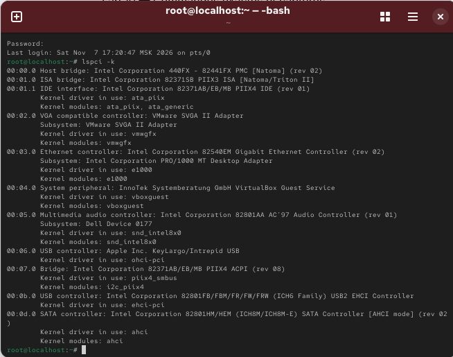

#### Просмотр загруженных модулей

Команда `lsmod | sort` отображает загруженные модули ядра и сортирует их по имени.

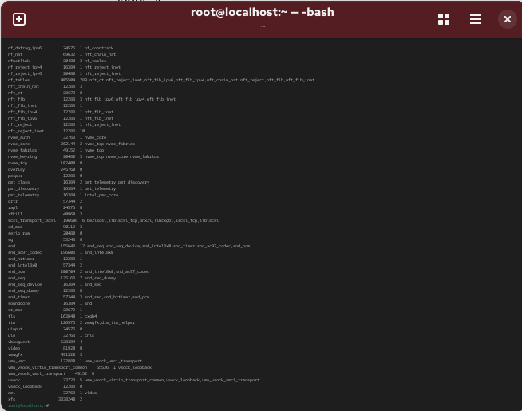

#### Проверка модуля ext4

Команда `lsmod | grep ext4` позволяет определить, загружен ли модуль ext4.

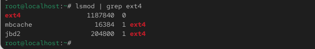

#### Загрузка модуля ext4

Команда `modprobe ext4` используется для загрузки модуля. После выполнения была проведена проверка с помощью `lsmod`.

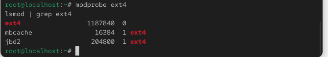

#### Получение информации о модуле ext4

Команда `modinfo ext4` отображает сведения о модуле ядра, включая его описание, автора, лицензию и другие характеристики.

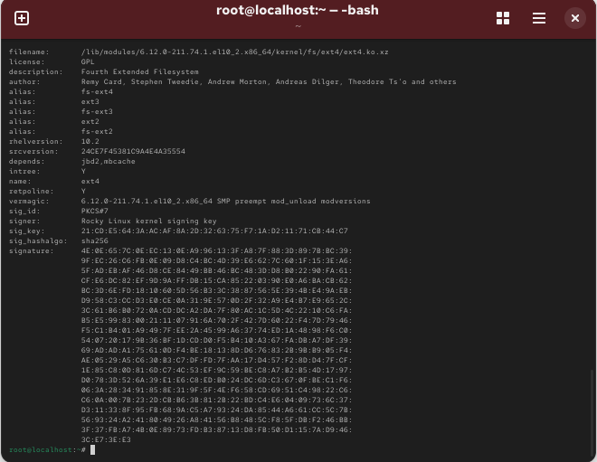

#### Попытка выгрузки модуля ext4

Команда `modprobe -r ext4` используется для выгрузки модуля. Результат выполнения зависит от того, используется ли модуль системой.

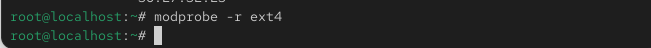

#### Попытка выгрузки модуля xfs

Команда `modprobe -r xfs` позволяет попытаться выгрузить модуль XFS. Если модуль используется, система сообщает об ошибке выгрузки.

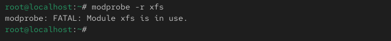

### 3.2. Загрузка модулей ядра с параметрами

#### Проверка модуля Bluetooth

Команда `lsmod | grep bluetooth` используется для проверки наличия модуля Bluetooth среди загруженных модулей.

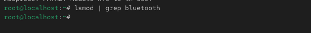

#### Загрузка модуля Bluetooth

Команда `modprobe bluetooth` выполняет загрузку модуля Bluetooth. После загрузки проверяется список соответствующих модулей.

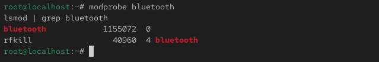

#### Получение информации о Bluetooth

Команда `modinfo bluetooth` позволяет получить подробную информацию о модуле и поддерживаемых параметрах.

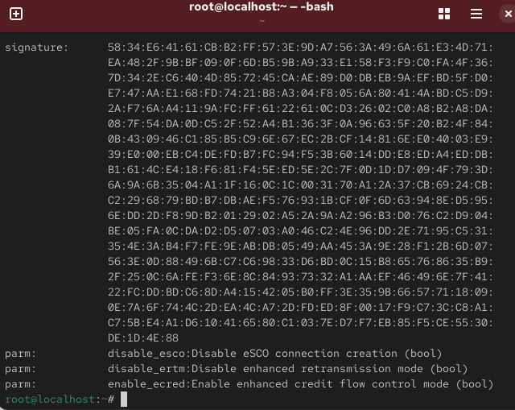

#### Выгрузка модуля Bluetooth

Команда `modprobe -r bluetooth` используется для выгрузки модуля Bluetooth.

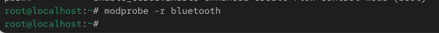

### 3.3. Обновление ядра системы

#### Проверка текущей версии ядра

Команда `uname -r` позволяет определить текущую версию используемого ядра операционной системы.

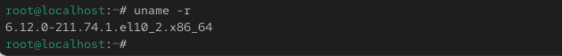

#### Просмотр пакетов ядра

Команда `dnf list kernel` отображает список пакетов ядра, доступных в системе и репозиториях.

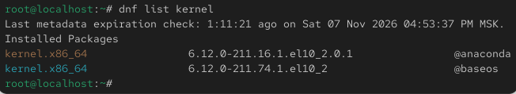

#### Обновление системы

Команда `dnf upgrade --refresh` обновляет информацию о репозиториях и выполняет обновление пакетов системы.

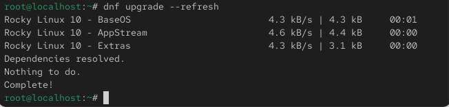

#### Обновление ядра

Команда `dnf update kernel` используется для обновления пакета ядра операционной системы.

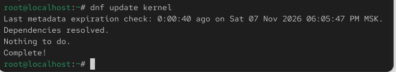

После этого выполняется обновление остальных пакетов системы.

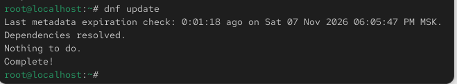

Повторное обновление системы выполняется командой `dnf upgrade --refresh`.

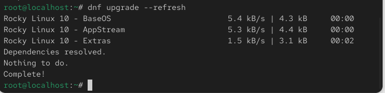

#### Проверка ядра после перезагрузки

После перезагрузки системы команда `uname -r` позволяет проверить используемую версию ядра. Команда `hostnamectl` отображает общую информацию об операционной системе.

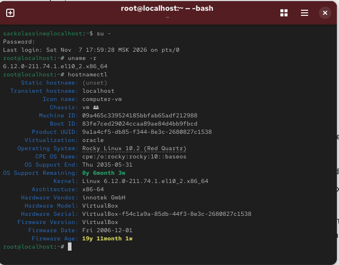

## 4. Вывод

В ходе лабораторной работы были изучены основные средства управления модулями ядра операционной системы Rocky Linux.

Были выполнены просмотр загруженных модулей, загрузка и выгрузка модулей ext4, xfs и bluetooth, получение информации о модулях с помощью `modinfo`, а также обновление ядра операционной системы.

Проверка версии ядра после перезагрузки позволила убедиться в корректности выполнения соответствующих операций.

Таким образом, цель лабораторной работы достигнута.

## 5. Ответы на контрольные вопросы

### 1. Какая команда показывает текущую версию ядра?

```bash
uname -r
```

### 2. Как посмотреть более подробную информацию о текущей версии ядра?

```bash
uname -a
```

Также можно использовать:

```bash
hostnamectl
```

### 3. Какая команда показывает список загруженных модулей ядра?

```bash
lsmod
```

### 4. Какая команда позволяет определять параметры модуля ядра?

```bash
modinfo имя_модуля
```

### 5. Как выгрузить модуль ядра?

```bash
modprobe -r имя_модуля
```

### 6. Что делать при ошибке выгрузки модуля?

Необходимо определить, используется ли модуль системой или другими модулями. Следует остановить соответствующие процессы или службы, если это безопасно, и повторить попытку выгрузки. Нельзя выгружать модуль, необходимый для работы системы.

### 7. Как определить поддерживаемые параметры модуля?

Для просмотра параметров используется команда:

```bash
modinfo имя_модуля
```

Особенно полезна строка `parm`, содержащая сведения о параметрах модуля.

### 8. Как установить новую версию ядра?

В Rocky Linux можно использовать менеджер пакетов DNF:

```bash
dnf update kernel
```

После установки нового ядра необходимо перезагрузить систему и проверить версию ядра:

```bash
uname -r
```

## 6. Список использованных источников

1. Кулябов Д. С., Королькова А. В. Основы администрирования операционных систем. Лабораторная работа № 10.
2. Руководства Linux: `man modprobe`, `man modinfo`, `man lsmod`.
