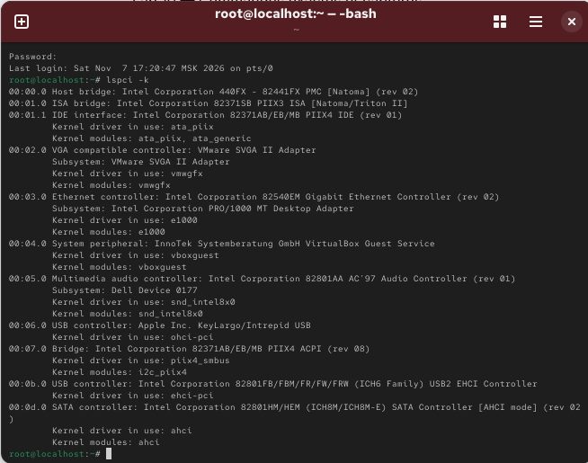
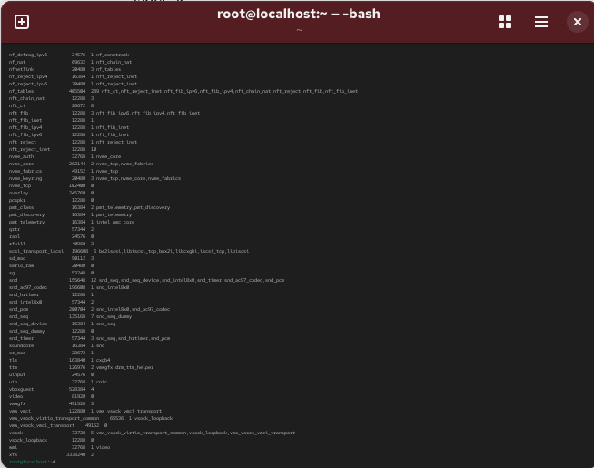
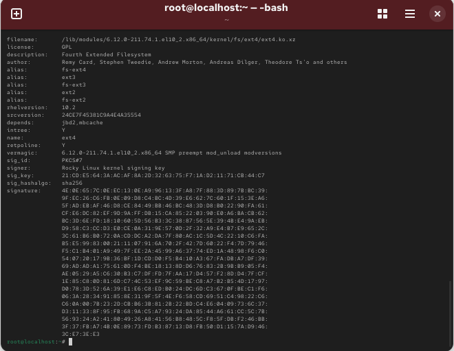
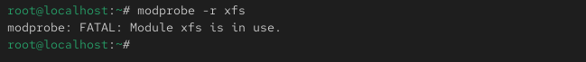
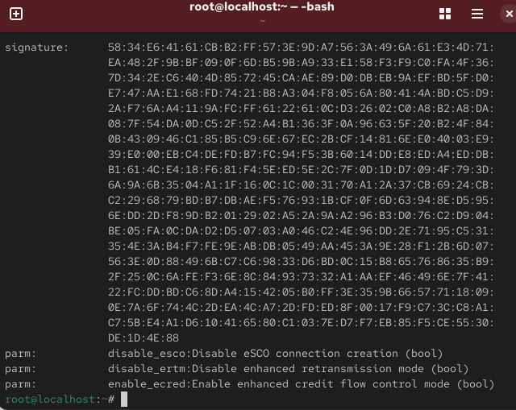
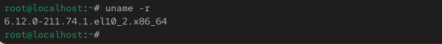
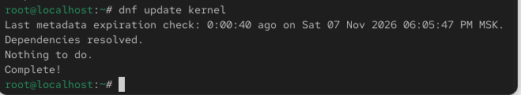
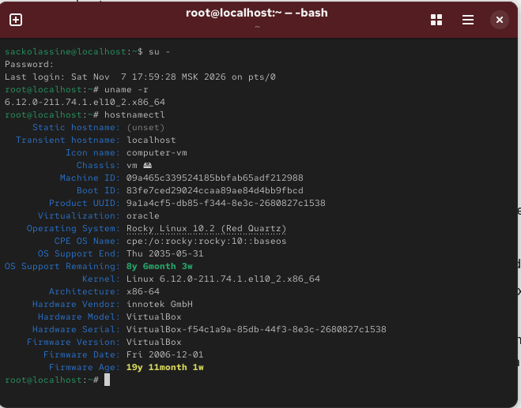

# Цель работы

- Изучить управление модулями ядра Linux.
- Научиться загружать и выгружать модули.
- Изучить просмотр параметров модулей.
- Ознакомиться с обновлением ядра ОС.

# Управление модулями ядра

Команда `lspci -k` позволяет определить устройства и связанные с ними модули ядра.

# Просмотр загруженных модулей

Команда `lsmod` отображает список загруженных модулей ядра.

# Работа с ext4

- `lsmod | grep ext4` — проверка модуля.
- `modprobe ext4` — загрузка модуля.
- `modinfo ext4` — получение информации.
- `modprobe -r ext4` — выгрузка модуля.

# Работа с xfs

Команда `modprobe -r xfs` используется для выгрузки модуля xfs.

# Работа с Bluetooth

- `lsmod | grep bluetooth`
- `modprobe bluetooth`
- `modinfo bluetooth`
- `modprobe -r bluetooth`

# Проверка версии ядра

Команда `uname -r` позволяет определить текущую версию ядра.

# Обновление ядра

- `dnf list kernel`
- `dnf upgrade --refresh`
- `dnf update kernel`
- `dnf update`

# Проверка результата

После обновления и перезагрузки системы выполняется команда `uname -r`.

# Выводы

- Изучены команды управления модулями ядра.
- Выполнены загрузка и выгрузка модулей.
- Получена информация о параметрах модулей.
- Изучены команды обновления ядра Linux.
