```{=latex}
\begin{titlepage}
\begin{center}
\textbf{Российский университет дружбы народов}\\
\textbf{Факультет физико-математических и естественных наук}\\[3cm]
{\Large ЛАБОРАТОРНАЯ РАБОТА № 11}\\[0.5cm]
{\large Управление загрузкой системы}
\end{center}

\vfill
\begin{flushright}
Выполнил: студент\\
Сако Лассине
\end{flushright}
\vfill

\begin{center}
Москва — 2026
\end{center}
\end{titlepage}

\clearpage
\tableofcontents
\clearpage
```

# Цель работы

Изучить процесс загрузки операционной системы Linux, освоить основные принципы работы загрузчика GRUB2, научиться изменять параметры загрузки, формировать конфигурационный файл загрузчика, а также изучить способы запуска системы в режимах восстановления и аварийного обслуживания.

# Задание

1. Изучить загрузчик GRUB2 и его основные параметры.
2. Получить информацию о версии GRUB2.
3. Изучить конфигурационный файл `/etc/default/grub`.
4. Изменить параметры загрузчика и сформировать новый конфигурационный файл.
5. Выполнить загрузку системы в различных режимах.
6. Изучить механизм восстановления пароля администратора.
7. Проверить результаты выполненных операций.

# Ход выполнения работы

## 1. Изучение загрузчика GRUB2

### 1.1. Проверка версии загрузчика

Для определения установленной версии загрузчика GRUB2 была выполнена команда `grub2-install --version`.

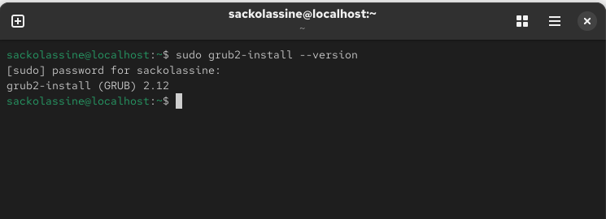

Полученная информация позволяет определить версию используемого загрузчика и подтвердить наличие соответствующей утилиты в системе.

### 1.2. Просмотр конфигурационного файла GRUB2

Для изучения параметров загрузчика был просмотрен файл `/etc/default/grub`.

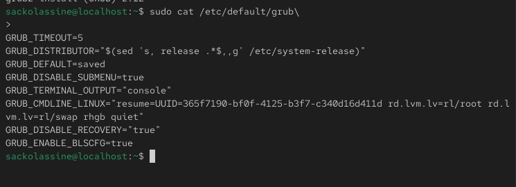

В данном файле содержатся параметры, определяющие поведение загрузчика, включая время ожидания, отображение меню и параметры передачи управления ядру Linux.

### 1.3. Изучение параметров загрузки

В ходе работы были изучены основные параметры конфигурации GRUB2 и их влияние на процесс запуска операционной системы.


Особое внимание было уделено параметру `GRUB_TIMEOUT`, определяющему время ожидания перед автоматическим запуском системы.

## 2. Изменение конфигурации GRUB2

### 2.1. Редактирование параметров загрузчика

Для изменения конфигурации загрузчика был открыт файл `/etc/default/grub` и выполнено редактирование соответствующих параметров.

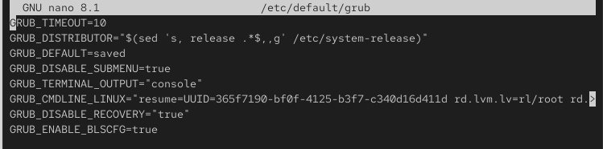

Изменение конфигурации позволяет управлять отображением меню загрузчика и параметрами запуска системы.

### 2.2. Генерация конфигурационного файла

После изменения параметров была выполнена генерация конфигурации GRUB2 с использованием команды:

`grub2-mkconfig -o /boot/grub2/grub.cfg`


Данная команда формирует конфигурационный файл загрузчика на основе установленных параметров и обнаруженных операционных систем.

### 2.3. Проверка сформированной конфигурации

После генерации был проверен результат выполнения команды и состояние конфигурационного файла загрузчика.


Проверка позволяет убедиться в наличии сформированного конфигурационного файла и корректности выполнения процедуры генерации.

## 3. Проверка загрузки системы

### 3.1. Перезагрузка операционной системы

После изменения конфигурации GRUB2 была выполнена перезагрузка системы для проверки результатов внесённых изменений.

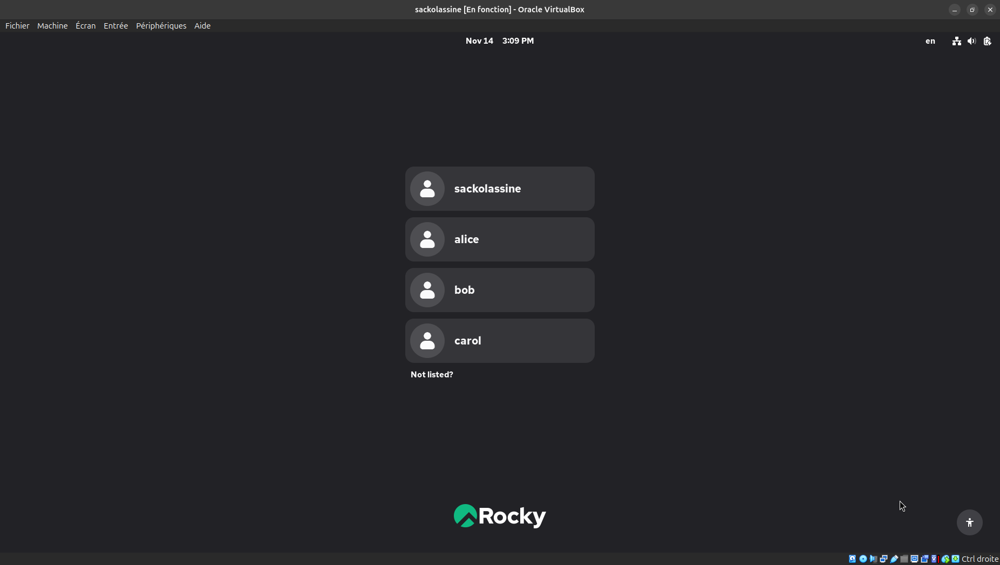

Перезагрузка позволяет проверить, применяются ли изменённые параметры загрузчика при следующем запуске системы.

### 3.2. Изучение меню загрузчика GRUB2

В процессе запуска системы был изучен интерфейс загрузчика GRUB2 и доступные параметры загрузки.

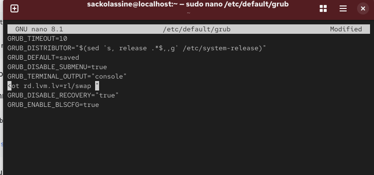

Меню GRUB2 предоставляет возможность выбора установленного ядра Linux и изменения параметров загрузки.

## 4. Загрузка системы в режим восстановления

### 4.1. Выбор режима восстановления

Для изучения режима восстановления была выполнена загрузка системы с использованием соответствующего параметра загрузки.

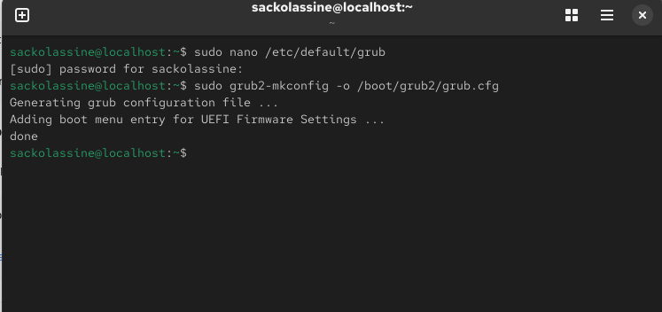

Режим восстановления предназначен для выполнения диагностических и восстановительных операций при возникновении проблем с обычной загрузкой системы.

### 4.2. Работа в режиме восстановления

После перехода в режим восстановления были изучены доступные средства диагностики и особенности работы в ограниченной среде.

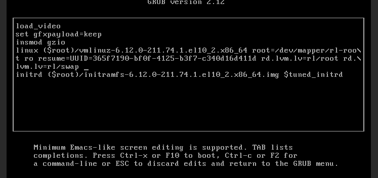

Данный режим позволяет выполнять обслуживание системы и устранять некоторые неисправности, препятствующие нормальной загрузке.

## 5. Загрузка системы в аварийный режим

### 5.1. Переход в Emergency Mode

Для изучения аварийного режима была использована возможность изменения параметров загрузки GRUB2.

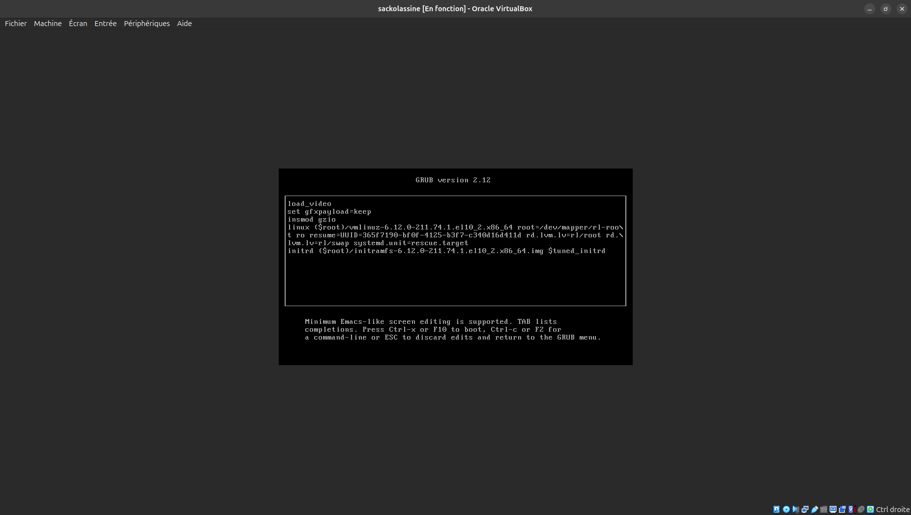

Аварийный режим предназначен для диагностики серьёзных проблем системы и предоставления минимальной среды обслуживания.

### 5.2. Изучение аварийного режима

После загрузки был изучен интерфейс аварийного режима и особенности доступа к системным инструментам.

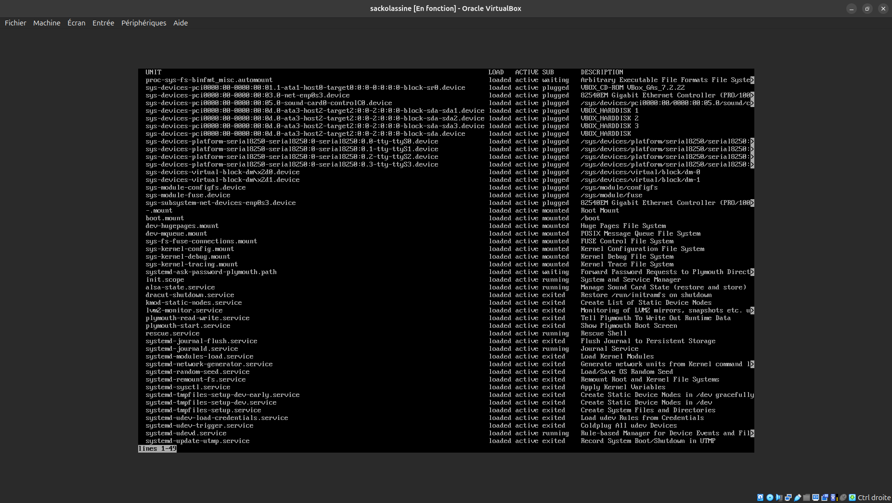

В аварийном режиме предоставляется минимальное окружение, необходимое для диагностики и восстановления операционной системы.

### 5.3. Проверка работы в аварийном режиме

В ходе выполнения работы были изучены особенности работы системы в аварийном режиме и ограничения доступа к некоторым компонентам операционной системы.

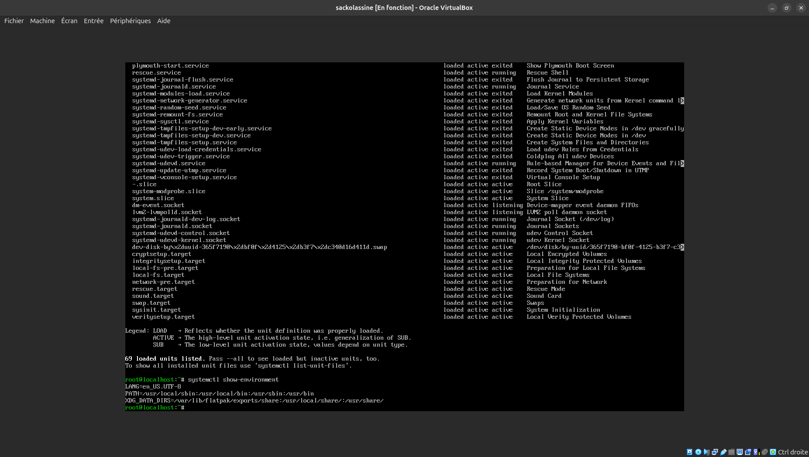

Полученные результаты позволяют понять назначение аварийного режима и его применение при устранении неисправностей.

## 6. Восстановление пароля администратора

### 6.1. Использование параметра rd.break

Для изучения процедуры восстановления пароля был изменён параметр загрузки GRUB2 с использованием `rd.break`.


Параметр `rd.break` позволяет остановить процесс загрузки на раннем этапе и перейти в специальную среду initramfs.

### 6.2. Подготовка среды восстановления

После остановки процесса загрузки были изучены команды подготовки файловой системы и перехода в окружение установленной операционной системы.

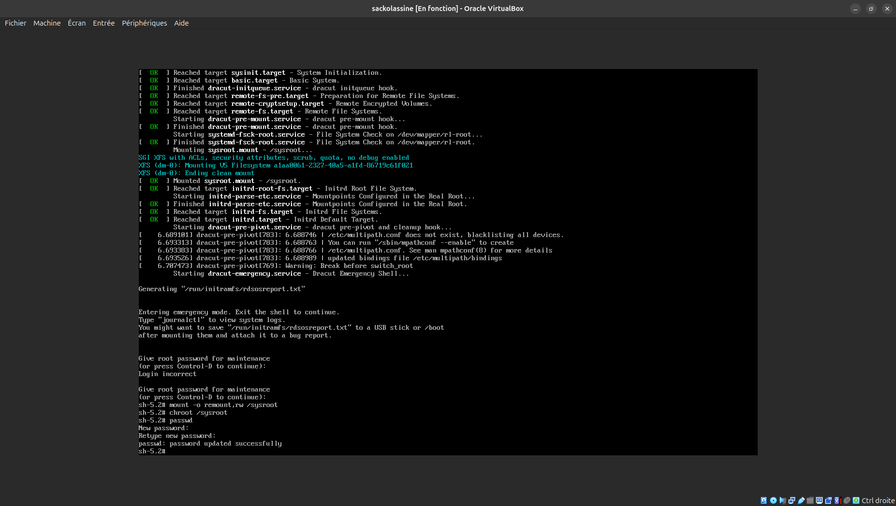

Для выполнения операций восстановления необходимо обеспечить возможность записи в файловую систему и получить доступ к установленной системе.

### 6.3. Работа с паролем администратора

В процессе восстановления были рассмотрены команды изменения пароля администратора и особенности работы с механизмом безопасности SELinux.

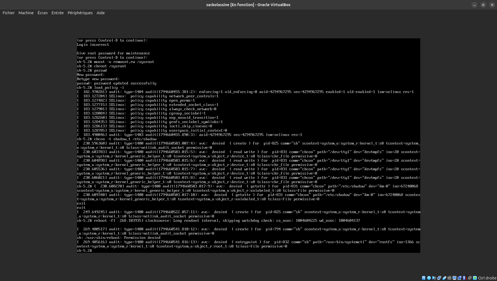

При восстановлении доступа в системах с SELinux необходимо учитывать корректность контекстов безопасности системных файлов.

### 6.4. Проверка результата восстановления

На завершающем этапе были изучены результаты выполненных операций восстановления и особенности последующего входа в систему.

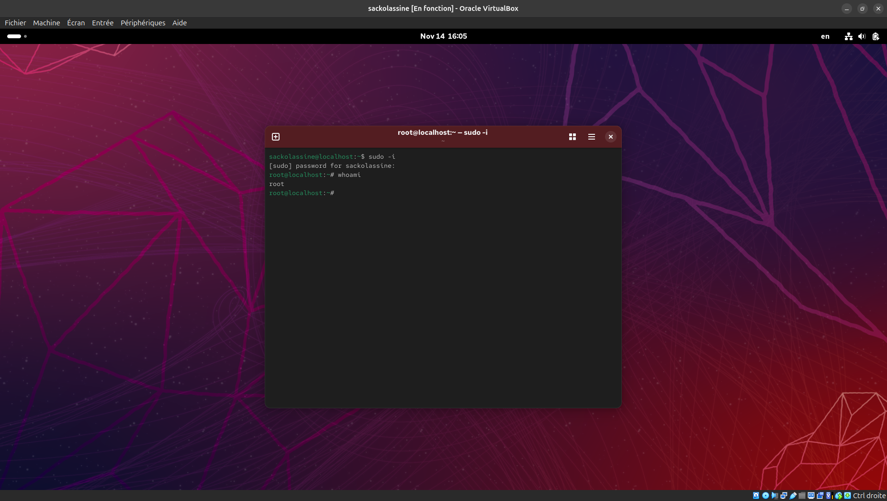

Полученные результаты демонстрируют особенности восстановления доступа к системе и необходимость проверки корректности выполненных действий.

# Выводы

В ходе лабораторной работы были изучены основные принципы управления загрузкой операционной системы Rocky Linux.

Были рассмотрены загрузчик GRUB2, его конфигурационные параметры, процесс формирования конфигурационного файла и особенности изменения параметров загрузки.

Также были изучены режимы восстановления и аварийной загрузки системы, а также механизм восстановления пароля администратора с использованием параметра `rd.break`.

В результате выполнения лабораторной работы были получены практические навыки управления загрузкой системы и изучены основные методы диагностики и восстановления доступа к операционной системе.

# Ответы на контрольные вопросы

## 1. Что такое GRUB2?

GRUB2 — это загрузчик операционной системы, предназначенный для выбора ядра Linux и передачи ему управления при запуске компьютера.

## 2. Где находится конфигурационный файл GRUB2?

Основные параметры загрузчика находятся в файле:

`/etc/default/grub`

Сгенерированный конфигурационный файл в Rocky Linux обычно находится по пути:

`/boot/grub2/grub.cfg`

## 3. Как сформировать конфигурационный файл GRUB2?

Для формирования конфигурационного файла используется команда:

`grub2-mkconfig -o /boot/grub2/grub.cfg`

## 4. Для чего используется параметр GRUB_TIMEOUT?

Параметр `GRUB_TIMEOUT` определяет время ожидания перед автоматическим запуском выбранного пункта меню загрузчика.

## 5. Что такое Rescue Mode?

Rescue Mode — это режим восстановления системы, предоставляющий ограниченную среду для диагностики и устранения неисправностей операционной системы.

## 6. Что такое Emergency Mode?

Emergency Mode — это аварийный режим загрузки, обеспечивающий минимальную среду для диагностики и восстановления системы.

## 7. Для чего используется параметр rd.break?

Параметр `rd.break` позволяет остановить процесс загрузки на раннем этапе и перейти в специальную среду initramfs для выполнения операций восстановления системы.

## 8. Как восстановить пароль администратора в Rocky Linux?

Для восстановления пароля можно использовать загрузку с параметром `rd.break`, подготовить файловую систему, перейти в окружение установленной системы и выполнить команду `passwd`.

При использовании SELinux необходимо учитывать корректность контекстов безопасности файлов.

# Список литературы

1. Кулябов Д. С., Королькова А. В. Основы администрирования операционных систем. Лабораторная работа № 11.
2. Документация Rocky Linux.
3. Документация GRUB2.
4. Справочные страницы Linux: `man grub2-mkconfig`, `man systemctl`, `man passwd`.
