# Управление загрузкой системы

**Лабораторная работа № 11**

Сако Лассине

РУДН — 2026

# Цель работы

Получить навыки работы с загрузчиком системы GRUB2.

Изучить:
- изменение параметров GRUB;
- устранение неполадок;
- восстановление доступа root.

# 1. Модификация GRUB2

Основной файл конфигурации:

`/etc/default/grub`

Параметр меню загрузки:

`GRUB_TIMEOUT=10`

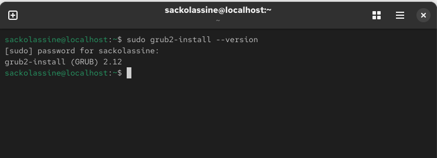

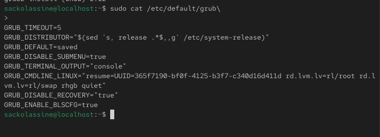

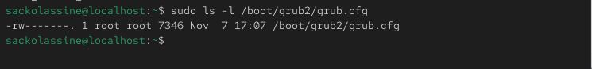

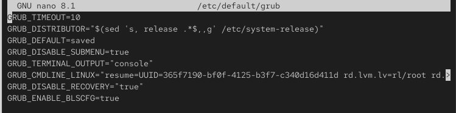

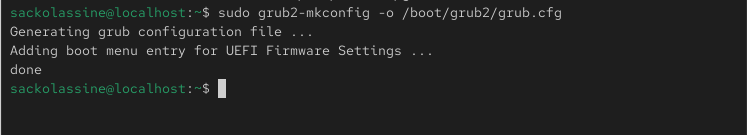

# 2. Устранение неполадок

Для запуска режима восстановления используется параметр:

`systemd.unit=rescue.target`

Для минимального режима:

`systemd.unit=emergency.target`

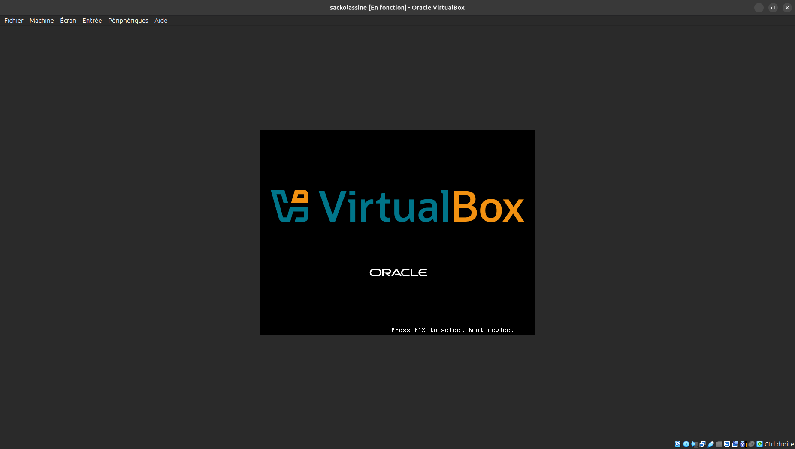

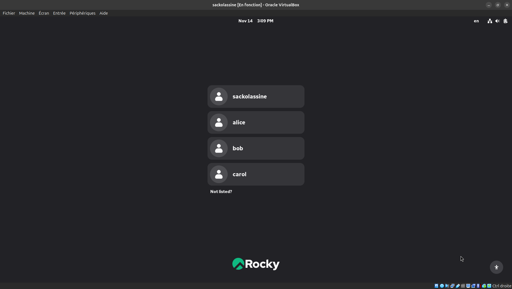

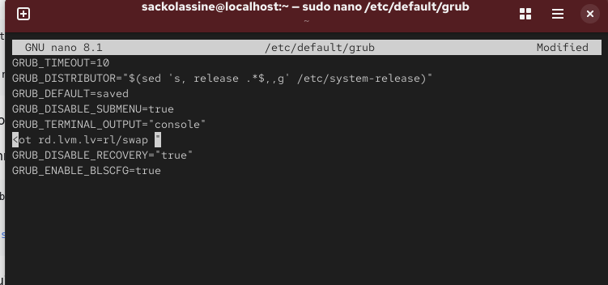

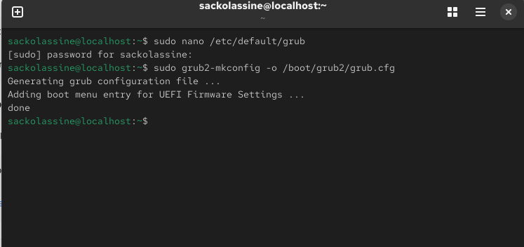

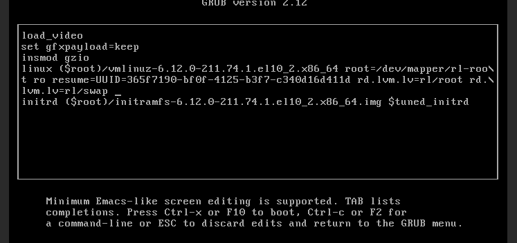

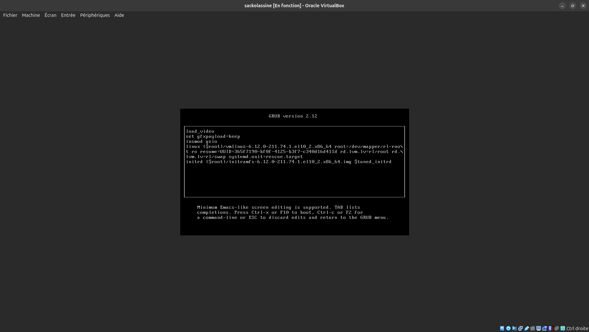

# 3. Работа без пароля root

Для остановки загрузки используется параметр:

`rd.break`

Основные команды:

```bash
mount -o remount,rw /sysroot
chroot /sysroot
passwd
```

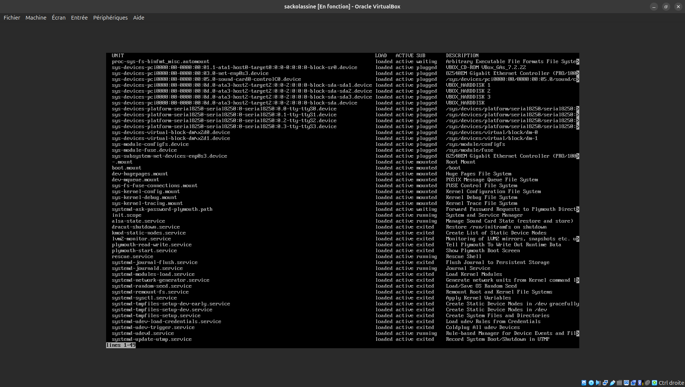

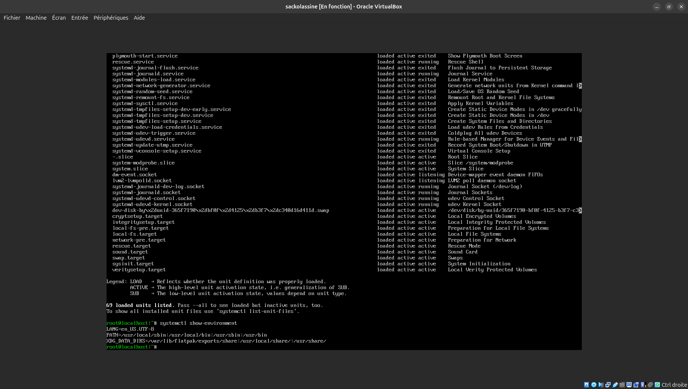


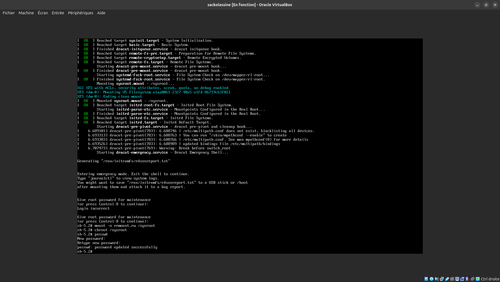

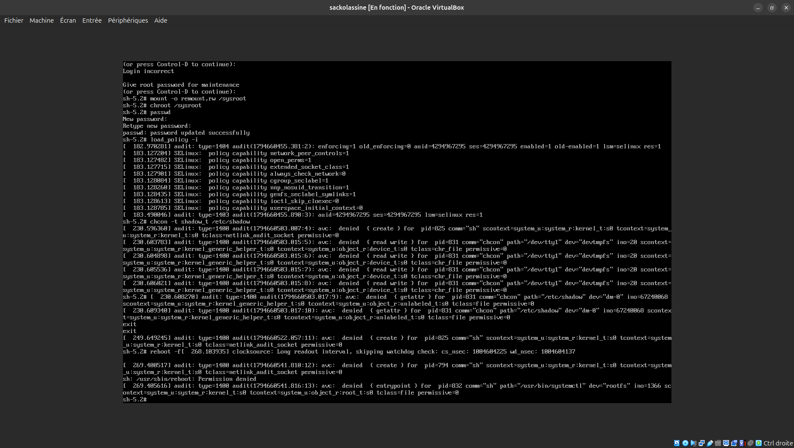

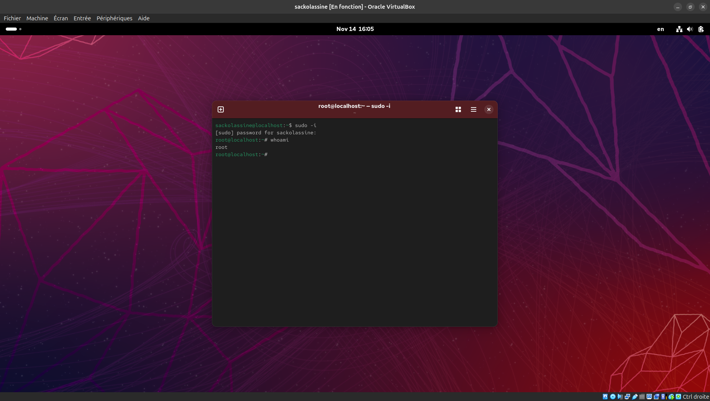

# Вывод

В ходе лабораторной работы были изучены параметры загрузчика GRUB2, режимы устранения неполадок и методы восстановления доступа root.

**Спасибо за внимание!**
